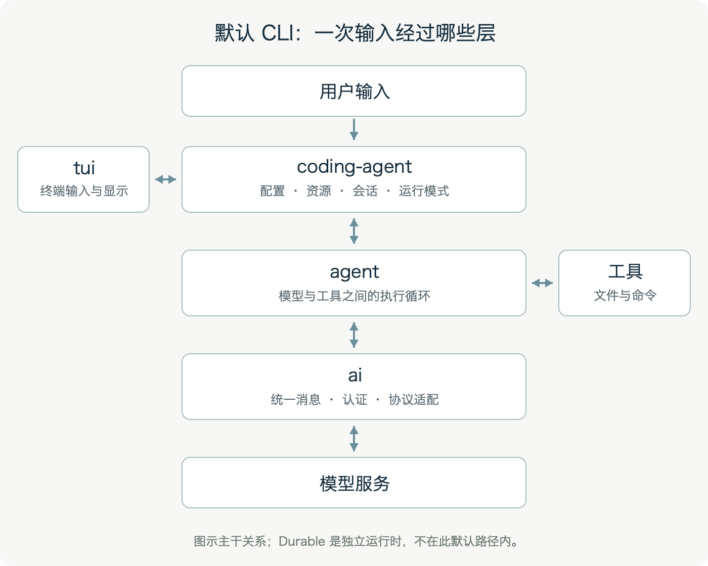
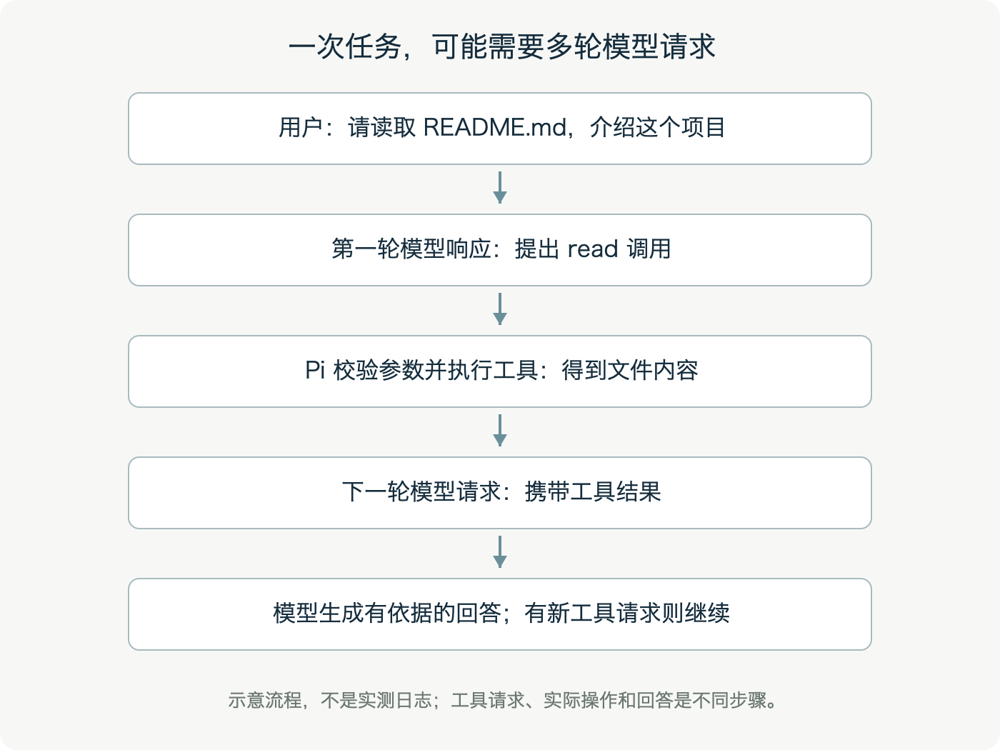
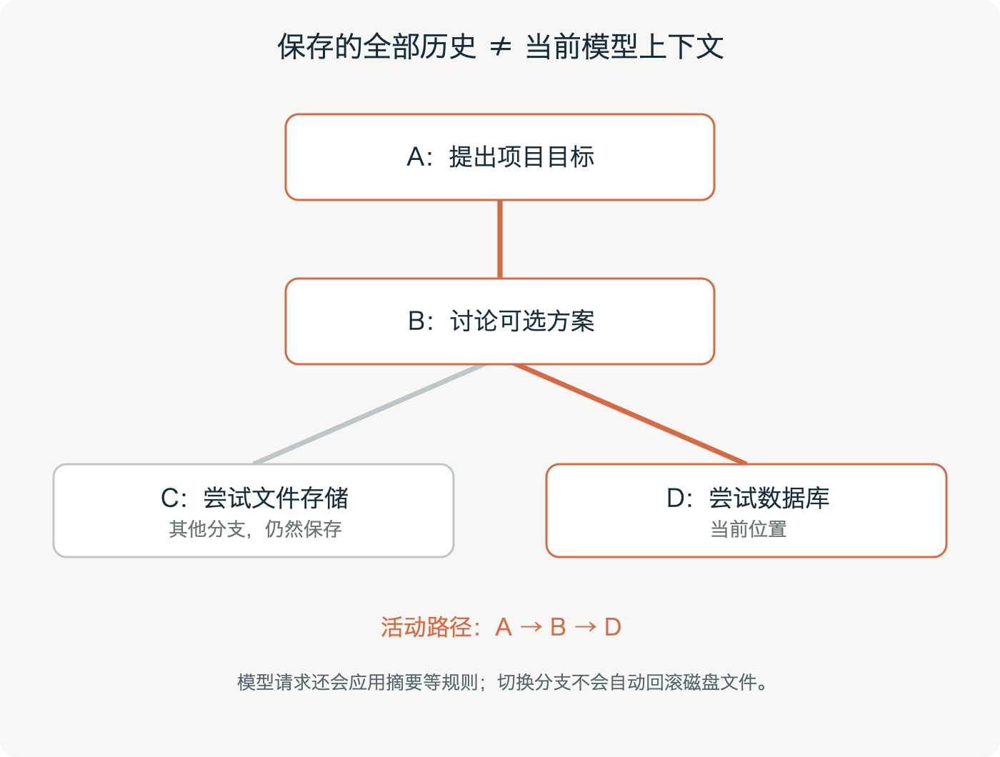

# 前言：从会使用，到看懂它怎样工作 {#preface}

这本书写给第一次接触 Pi、也可能第一次认真打开一个软件工程的人。你不必先掌握 TypeScript，不必知道模型接口怎样调用，也不必理解所有文件。我们从一个具体的问题开始：当你在终端里输入“请帮我修改这段代码”时，究竟是谁读取文件，谁生成修改方案，谁执行命令，又是谁保存这次对话？

Pi 把这些工作拆在几个可以配合、也可以分别使用的软件包里。本书的目标，是帮你在脑中建立一张能用的地图。读完以后，你应该能说明 Pi 的主要用途，知道常见目录的职责，跟着一次输入走过核心执行流程，并在遇到问题时找到合适的文档或源码入口。

全书采用同一个方法：先提出问题，再走一个短例子，最后解释工程怎样解决它。代码只在能帮助理解的时候出现。第一次遇到专业词语时，我们会先解释；附录还准备了一份中英术语表，方便回查。

## 本书依据哪个工程版本

本书依据 `earendil-works/pi` 源码仓库编写，代码基准为提交 `16f5f0af4d85ca583d045ceb5ed6d646fcaf7761`，整理日期为 2026 年 10 月 20 日。该快照中的主要公开包版本为 `1.3.0`；Pi 源码根目录 `package.json` 的版本字段有自己的用途，不能用它代替各个包的版本。

书中章末的“源码依据”链接都固定到这次提交，便于你对照阅读。链接需要联网打开，但正文、目录、插图和练习都已装入 EPUB，离线也能阅读。未来版本可能改变命令、文件位置和接口；实际操作时，以你安装版本的 `pi --help`、交互命令和随包文档为准。

这是基于源码整理的中文学习读物，由 AI 辅助编写，不是项目维护者发布的官方手册。架构说明来自本次代码与文档检查；示例中的任务、对话和输出用于解释流程，不代表已经替你运行了真实模型请求。本书制作过程没有调用付费模型接口来验证任务效果。

## 怎样选择阅读顺序

如果你完全没有编程经验，请按顺序阅读第一至第四章。第二章专门解释终端、目录、Node.js、npm、TypeScript 和 JSON。初次阅读时，能说清它们各自负责什么就够了。

如果你已经会使用命令行，可以先读第三章建立目录地图，再进入第五至第八章，了解输入、执行循环、模型接口和会话。第九至第十三章介绍扩展、终端、外部工具，以及持久化和远程执行。它们是逐步拓宽视野的章节，不需要一次掌握。

如果你准备自己修改 Pi，请重点读第十四、十五章：前者教你按问题阅读源码，后者解释本仓库的开发与测试规则。第十六章把常见问题和一周学习路线放在一起，适合边用边查。

| 阅读目标 | 建议章节 | 可以完成的事情 |
|---|---|---|
| 先知道 Pi 是什么 | 第一至第三章 | 解释模型、工具和 Agent 的关系，认识工程目录 |
| 第一次实际使用 | 第四章、第八章 | 启动 Pi，选择模型，理解保存和恢复会话 |
| 理解内部执行过程 | 第五至第七章 | 跟踪一条消息怎样变成模型请求和工具调用 |
| 定制和集成 | 第九至第十三章 | 选择合适的扩展方式，区分不同运行时 |
| 开始读码和开发 | 第十四至第十六章 | 找到入口，按仓库规则检查和测试 |

## 阅读和练习的约定

书里的代码块会注明用途。`bash` 代码块一般表示在终端输入的命令；`text` 表示目录、流程或示意输出。出现 `/login` 这样的斜杠命令时，它是在 Pi 的输入框里使用的，不是直接交给系统终端。出现 `src/`、`packages/` 等路径时，若未说明，都是相对于 **Pi 源码仓库**根目录。当前存放书稿的网站仓库是独立的 `pi-beginner-book-zh`，其中没有 Pi 的 `packages/` 或 `pi-test.sh`。第十五章的开发命令需要先进入 Pi 源码仓库，再执行；书籍网站的构建方式另见本书仓库的 README。

你可以先读练习题，再看参考答案。练习主要检验理解，不要求付费账户或真实远程服务器。涉及实际修改时，使用自己创建的练习目录，保留修改前的内容。Pi 可以调用文件和命令工具；在当前默认设计中，它继承启动进程的权限。给练习任务安排清楚的工作范围，也是理解工具能力的一部分。

EPUB 是可以随着屏幕宽度和字号重新排版的电子书格式，因此本书按章和小节导航，没有固定页码。手机上遇到较长路径时可以横屏查看；不需要为了跟上“第几页”而保持某一种字号。

先从第一章开始。你要认识的第一件事，是“生成一段回答”和“真正完成一次代码修改”之间，需要哪些具体步骤。

# 第一章 Pi 能帮你做什么 {#ch01}

## 1.1 从一个小任务认识它

假设你有一个小项目，里面有个函数叫 `add`，但它错误地把两个数相减。你希望有人查看文件，找出问题，把减号改成加号，再检查结果。这个任务很短，却已经包含几种不同工作：理解要求、获取项目内容、决定怎样修改、真正写入文件、判断修改是否有效。

在 Pi 里，你可以用自然语言提出这件事。例如：“请看看 `calculator.js` 里的 `add`，修复加法，并告诉我改了什么。”这句话是任务的入口。Pi 接下来会把相关信息交给模型，让模型在可用工具的帮助下逐步处理。文件是否读取成功、修改是否匹配、检查是否通过，都可能影响下一步。

“工具”是软件实际能够调用的操作。读取文件是一种工具，执行命令是一种工具，修改文件也是一种工具。工具执行后有结果：可能是文本，也可能是错误。例如读取一个不存在的文件，应该得到文件错误；它不会因为模型希望文件存在，就自动变成成功。

“Agent”在本书中指一种工作方式：程序让模型作出下一步选择，执行被选择的工具，把结果交回模型，再决定是否继续。它通常要经过多轮交互。Pi 提供了实现这套流程的运行框架，并把常用编程工具、会话管理和终端界面组合成了可以直接使用的命令行产品。

你第一次使用时，可以把它想成一个需要看到材料、也需要收到检查反馈的编程协作者。任务说明越具体，它越容易判断应当查看哪里，以及怎样确认完成。

## 1.2 模型、工具和运行框架分别负责什么

模型接收消息，并生成后续内容。它可能直接回答，也可能生成结构化的工具调用请求。例如，它请求名为 `read` 的工具，并给出一个文件路径。这个请求本身只是数据；操作系统不会因为数据里出现了 `read` 就自行读文件。

Pi 中的运行框架负责接住这个请求。它需要找到工具，检查参数是否符合要求，真正执行工具，再把结果放回后续消息中。若用户取消任务，它还要传递取消信号。若界面要显示进度，它还要发布执行事件。这些工作共同决定“一个回答”怎样变成“一个能够持续推进的过程”。

工具负责具体操作。默认编程工具包括 `read`、`bash`、`edit` 和 `write`。`read` 读取内容；`bash` 运行命令；`edit` 根据匹配内容修改文件；`write` 写入文件内容。模型不会自动拥有你电脑上的所有功能，它只能使用宿主程序提供给它的能力。反过来，工具一旦执行了真实写入，工作目录里的文件也就真的改变了。

还有一种参与者叫“模型服务提供方”，即接受模型请求的服务。Pi 的统一接口支持多家提供方。你选择哪家服务、哪个模型，以及使用什么认证方式，会影响可用能力、响应速度、费用和限制。把模型换成另一家，并不意味着文件工具也要重写；这正是分层设计要解决的问题。

可以用下面这张责任表记忆它们：

| 参与者 | 主要工作 | 在加法例子中的行为 |
|---|---|---|
| 用户 | 提出目标和约束 | 要求修复 `add`，说明修改范围 |
| 模型 | 根据消息生成回答或工具请求 | 建议先读取文件，再执行修改 |
| Agent 运行框架 | 串联调用、状态和事件 | 执行工具，把结果交回模型 |
| 工具 | 操作具体资源 | 读取、写入文件，运行检查 |
| 界面和会话层 | 接收输入、显示和保存过程 | 展示差异，保存本次对话 |

## 1.3 一次修改为什么会有多轮

把加法任务拆开，就能看到一次常见的执行过程。下面是解释用的流程，不是已经运行过的日志：

```text
用户：修复 calculator.js 中的 add
模型：请求 read，查看 calculator.js
工具：返回函数内容
模型：请求 edit，把错误的表达式改成加法
工具：返回修改结果
模型：根据项目情况请求相关检查
工具：返回检查结果
模型：说明修改和验证情况
```

如果第二步显示文件路径不正确，后面就不能原样继续。模型可能需要列目录或让用户补充信息。如果修改工具报告没有找到预期内容，也应该重新查看文件，而不是宣布修复完成。工具结果之所以必须回到模型消息中，是因为后续决定依赖现实状态。

你也可以给出更有限的任务：“只解释这个函数，先不要修改。”这时任务目标改变，读取和回答可能就足够。对于仓库中的程序，项目规则也会约束如何处理，例如只能运行特定测试，或不得擅自提交代码。这些约束会进入上下文，影响模型的选择；具体操作仍由实际工具和执行环境完成。

对新手来说，先观察这条链路比先学习所有命令更有效。看到一条工具记录时，问自己：它要获取什么证据？返回了什么？这份结果怎样改变下一步？这三个问题能够帮助你分辨“有一段看起来合理的文字”与“有可以检查的执行依据”。

## 1.4 命令行产品和可复用基础库

从使用者角度看，最明显的产品是 `pi`：你在终端里启动它，输入要求，看到流式回答和工具记录。从工程角度看，仓库还提供了一组基础库。开发者可以只调用模型，也可以把 Agent 放到自己的应用里，或者通过 RPC 让另一个程序控制 Pi。

“CLI”是 Command-Line Interface 的缩写，意思是命令行界面。“SDK”是 Software Development Kit 的缩写，意思是供其他程序使用的开发接口。“RPC”指进程或程序之间的一种远程调用方式；在 Pi 的 RPC 模式中，另一个程序可以发送结构化命令，并接收事件。你不需要在第一天就写 SDK 程序，但理解它们都是入口形式，有助于看懂目录为何分成多个包。

这个仓库还有独立的持久化运行时 `durable`，以及状态同步、远程执行、外部工具协议等模块。它们扩展了工程的应用范围。我们会在后面单独介绍，并清楚区分：哪些能力属于默认 CLI，哪些需要配置或扩展，哪些属于独立基础库。

### 本章小结

Pi 把自然语言输入、模型选择、工具执行、界面和会话组织在一起。它的关键过程是反复接收真实工具结果，再决定下一步。先理解各方的职责，就能避免把模型输出、实际执行和最终验证混在一起。

### 练习与参考答案

**练习一：** 模型生成了一段“建议修改后的代码”，这是否证明磁盘上的文件已经变化？

**参考答案：** 不能证明。需要执行写入或修改工具，并检查实际文件。模型生成内容与工具实施操作是两件事。

**练习二：** 读取工具返回“文件不存在”，为什么要把错误也交回模型？

**参考答案：** 后续计划依赖这份事实。模型可以据此修正路径、查看目录或询问用户；忽略错误会使后续步骤建立在错误前提上。

**练习三：** 在自己的应用里只想向模型发送一次请求，应该先了解哪一层？

**参考答案：** 先了解 `packages/ai`。需要自动执行工具并继续推进时，再了解 `packages/agent`；需要 Pi 的完整会话能力时，再看 `coding-agent` 的 SDK。

### 本章源码依据

- [根 README：定位、使用方式与权限边界](https://github.com/earendil-works/pi/blob/16f5f0af4d85ca583d045ceb5ed6d646fcaf7761/README.md)
- [coding-agent 包说明与依赖](https://github.com/earendil-works/pi/blob/16f5f0af4d85ca583d045ceb5ed6d646fcaf7761/packages/coding-agent/package.json)
- [内置工具入口](https://github.com/earendil-works/pi/blob/16f5f0af4d85ca583d045ceb5ed6d646fcaf7761/packages/coding-agent/src/core/tools/index.ts)
- [Agent 核心循环](https://github.com/earendil-works/pi/blob/16f5f0af4d85ca583d045ceb5ed6d646fcaf7761/packages/agent/src/agent-loop.ts)

# 第二章 读工程前，先认识这些基本概念 {#ch02}

## 2.1 终端、命令和当前目录

终端是一个让你输入文字指令、查看文字结果的窗口。你在其中输入的指令，通常先由一个叫“Shell”的程序解释。macOS 常见的 Shell 是 zsh，很多 Linux 环境使用 bash。终端、Shell 和 Pi 各有职责：终端提供窗口，Shell 解释系统命令，Pi 是可以从 Shell 启动的一个程序。

例如输入 `pi`，通常表示让 Shell 查找并启动一个叫 `pi` 的命令。Pi 启动后，你在它的输入框里输入自然语言，接收内容的程序就变成了 Pi。以后遇到 `/login`、`/model` 这样的命令，要记住它们属于 Pi 的交互界面。把 `/login` 直接敲在系统 Shell 中，系统不会因此自动完成 Pi 登录。

程序启动时有一个“当前工作目录”。许多相对路径都从这里解释。若当前目录是 `/home/lin/demo`，路径 `src/main.ts` 通常指向 `/home/lin/demo/src/main.ts`。以 `/` 开始的 Unix 路径通常是绝对路径；`../` 表示上一级目录。Windows 的绝对路径形式不同，核心问题仍是“从哪里开始找”。

在 macOS 或 Linux 的 Shell 中，可以用以下命令认识目录：

```bash
pwd
ls
```

`pwd` 显示当前目录，`ls` 列出目录内容。用 `cd` 切换目录时，要把示例路径换成你电脑上的真实路径。文档中的 `/path/to/project` 是占位符，不是一个保证存在的目录。本书不会让你为了理解一个例子而猜测某个文件必定已经存在。

对 Pi 来说，目录尤其重要：项目配置、上下文文件、工具读取路径和会话归属都与工作范围有关。遇到“它读错了项目”的情况，第一步先确认从哪个目录启动，而不是立即怀疑模型不能理解要求。

## 2.2 Node.js、npm 和软件包

JavaScript 是一种编程语言。Node.js 是运行 JavaScript 的环境，使程序可以在浏览器之外使用文件、网络和进程等能力。Pi 的主要代码围绕 Node.js 运行，本快照要求 Node.js 至少为 `22.19.0`。版本号是运行环境的版本，不是 Pi 的版本。

npm 是一个包管理工具。“包”可以理解为一组可以安装和复用的代码及其说明。`package.json` 是包的说明文件，它会记录名称、版本、依赖和脚本。“依赖”指这个包工作时还需要使用的其他包。安装一个软件时，包管理器往往还会安装它的依赖，因此你看见的实际文件比项目自己编写的源文件多得多。

在 Pi 的根目录中，`package.json` 使用 `workspaces` 把多个包组织在同一个仓库里。这种组织方式叫 monorepo，即多包共用一个仓库。`packages/ai` 和 `packages/agent` 各有自己的包说明，但可以在同一次开发中协调修改。

`package-lock.json` 记录依赖解析的精确结果，帮助不同机器安装一致的版本。`node_modules` 是安装后放置依赖的目录。初次读源码时，通常先看项目自己的 `packages/*/src`；需要核对外部库接口时，再查 `node_modules` 中的类型和实现。

两个看起来接近的命令，目的可能不同：

```bash
npm install --ignore-scripts
npm run check
```

前者安装依赖，并跳过安装生命周期脚本；后者运行本项目在 `scripts.check` 中定义的检查。`npm run` 后面的名称不是语言内置指令，必须回到当前项目的 `package.json` 看它具体执行什么。在本工程里，`check` 包含格式写入步骤，开发章节会进一步解释。

## 2.3 TypeScript、模块与异步

TypeScript 在 JavaScript 基础上增加了类型描述。类型让工具在运行前检查一些明显不匹配的用法。例如，一个函数声明输入应为数字，你却传入一份任意对象，类型检查就可能提前报错。

下面是只用来说明语言的例子，与 Pi 的公开 API 无关：

```typescript
function add(left: number, right: number): number {
  return left + right;
}

const result = add(2, 3);
```

`function` 定义函数，可以把它理解成一个有名字、可重复调用的步骤。`left` 和 `right` 是参数；冒号后的 `number` 表示数字类型。`return` 给出结果。`const` 创建一个不能重新赋值的变量名。你现在不必记住全部语法，能找到输入和输出就已经可以读懂不少工程代码。

文件之间通过“模块”协作。一个模块可以用 `export` 导出功能，另一个模块用 `import` 导入。本仓库使用 ESM，也就是 JavaScript 的标准模块系统。读到一串导入时，可以先看来自哪个包：它通常透露了当前文件负责哪一层，以及依赖哪一层。

很多操作不会立即完成，例如等待网络响应、等待工具执行结束。“异步”指程序可以等待这些操作，而不把它们假定为瞬间返回。在源码里，`async` 和 `await` 常常围绕这种等待出现。`Promise` 表示一个未来才会得到结果或错误的操作。

流式回答进一步把“一次操作”拆成一系列事件。你可能先收到一小段文本，接着收到更多文本，最后才收到结束事件。因此屏幕上已有内容，并不等于整个请求已经成功完成。模型请求、工具执行和界面更新会在不同时间发生，这也是 Agent 需要明确状态和事件的原因。

## 2.4 JSON、JSONL 和状态

JSON 是一种保存结构化数据的文本格式。它用对象、数组、字符串、数字等来表达信息。下面这份数据只解释 JSON 的样子，不是 Pi 的设置文件，也不能直接拿去配置 Pi：

```json
{
  "title": "练习项目",
  "enabled": true,
  "files": ["calculator.js", "README.md"]
}
```

花括号表示对象；`title` 这样的字符串是字段名；方括号表示数组。JSON 中的字段名和字符串使用双引号。很多 JavaScript 代码里可以写的内容，例如函数和普通注释，并不属于 JSON 的标准语法。

JSONL 表示每一行都是一个完整 JSON 值。它适合逐条追加记录。Pi 的 CLI 会话就使用 JSONL，并通过条目之间的父子关系表达分支。要注意，“文件是一行一条记录”只说明存储形式；每条记录有哪些字段、怎样关联，仍由项目自己的数据结构决定。不要自行编造一行 JSON 就当作合法会话文件。

“状态”是程序在某个时刻记住的信息。例如当前选择的模型、已经收到的消息、某个工具是否正在运行，都可以是状态。“事件”则描述发生了什么，例如开始生成、文本增加、工具结束。你可以把事件看成推动状态变化的通知。理解这个区别后，终端为何能实时更新、会话为何需要持久化，都会更容易解释。

### 本章小结

终端是操作入口，当前目录决定许多路径的含义。Node.js 提供运行环境，npm 管理依赖，TypeScript 帮助描述和检查代码。模块连接文件，异步处理等待，JSON 保存数据。先理解这些词的职责，不需要一次学完一门语言。

### 练习与参考答案

**练习一：** 在系统终端输入 `/model` 没有打开模型选择，应该先检查什么？

**参考答案：** 检查是否已经进入 Pi 的交互界面。斜杠命令属于 Pi；系统 Shell 并不负责解释它。

**练习二：** 想知道 `npm run check` 会做什么，应该看哪个文件？

**参考答案：** 看当前项目的 `package.json`，找到 `scripts` 下的 `check`。名字相同的脚本，在不同项目中可能做不同事情。

**练习三：** 为什么“已显示第一行回答”不能证明模型请求已成功结束？

**参考答案：** 流式请求会陆续发送事件。后续仍可能取消或失败，必须结合结束状态判断。

### 本章源码依据

- [根 package.json：工作区、脚本和 Node.js 要求](https://github.com/earendil-works/pi/blob/16f5f0af4d85ca583d045ceb5ed6d646fcaf7761/package.json)
- [基础 TypeScript 配置](https://github.com/earendil-works/pi/blob/16f5f0af4d85ca583d045ceb5ed6d646fcaf7761/tsconfig.base.json)
- [根 TypeScript 配置及包路径映射](https://github.com/earendil-works/pi/blob/16f5f0af4d85ca583d045ceb5ed6d646fcaf7761/tsconfig.json)
- [会话存储实现](https://github.com/earendil-works/pi/blob/16f5f0af4d85ca583d045ceb5ed6d646fcaf7761/packages/coding-agent/src/core/session-manager.ts)

# 第三章 给整个工程画一张地图 {#ch03}

## 3.1 先按职责认路

第一次打开 Pi 仓库，你会看到很多包、测试、脚本和文档。若从第一个文件逐个往后读，很容易在尚未知道目的时就被实现细节淹没。更有效的办法是先问：这个目录解决什么问题？谁会使用它？它依赖什么？

根目录的 `README.md` 解释工程定位和基本用法；`AGENTS.md` 记录开发规则；`package.json` 组织工作区与脚本；`scripts/` 放各种构建、检查、发布和维护工具。产品与库的主体集中在 `packages/` 下。测试通常跟随各包放置，因此同一功能的实现和测试可能隔着一个 `src` 与 `test` 目录。

一个简化的目录地图如下。它只保留读书时需要先认识的部分，并非仓库的全部文件：

```text
pi/
  README.md                工程总览
  AGENTS.md                开发约定
  package.json             工作区和命令脚本
  packages/
    coding-agent/          CLI、SDK、会话和扩展
    agent/                 模型与工具执行循环
    ai/                    统一模型接口
    tui/                   终端界面
    durable/               独立持久化运行时
    chord/                 对象、契约和状态同步
    mcp/                   外部工具协议客户端
    codemode/              工具脚本执行沙箱
    env/                   远程执行环境
    telemetry/             执行追踪与指标
    evals/                 行为效果评估
  scripts/                 工程维护脚本
  pi-test.sh               从源码启动 Pi
  test.sh                  隔离环境的测试入口
```

这里的“启动脚本”和“测试脚本”尤其容易混淆。`pi-test.sh` 虽然名字里有 `test`，主要用途却是从源码启动 Pi；`test.sh` 才是仓库提供的隔离测试入口。判断命令用途，应看脚本内容，不应仅凭名字猜测。

## 3.2 默认 CLI 的主干是怎样分层的

用户启动的命令来自 `coding-agent`。它处理命令行参数，选择交互界面、一次性输出、JSON 流或 RPC，并组织会话、资源和模型配置。它还把工具、项目上下文和扩展组织成一个可以运行的会话。

`agent` 负责更通用的执行过程。它接收输入，让模型生成回复；模型提出工具调用时，执行工具并记录结果；有必要时继续请求模型。这个包不需要知道终端上用了哪种边框，也不需要自己实现每家模型厂商的协议。

`ai` 把不同模型服务整理成统一接口。服务的模型目录、认证、请求格式和流式协议存在差异，上层不应为每家服务复制一套 Agent 循环。`ai` 处理这些差异，上层围绕统一的消息和事件工作。

`tui` 负责终端显示和输入。它处理多行编辑、Markdown、选择列表、终端宽度等问题。流式内容不断增加时，界面可以按变化更新，而不是每次粗暴重画所有内容。这个包的关注点是“怎样在终端上显示”，与“下一步应调用什么工具”分开。



图中的箭头表示主要调用关系。工具结果会返回 Agent，模型流也会返回上层。实际实现还包含事件订阅、错误处理和取消信号；先掌握主干，再逐步补充这些细节。

## 3.3 扩展能力和另一条运行时路线

`mcp` 提供 Model Context Protocol 客户端。可以先把 MCP 理解为一种接入外部工具的通用协议：工具可能运行在另一个进程，也可能位于网络服务中。该包处理连接、请求和协议；它不自动决定模型何时使用工具。

`codemode` 允许模型生成一段 JavaScript，在受限制的执行环境中组合调用注入的工具。例如先读取多份数据，在脚本里整理，只把摘要交回模型。这样可以减少进入模型上下文的中间内容。它提供的是脚本执行机制，脚本能操作什么仍取决于宿主注入的工具。

`durable` 走的是独立持久化运行时路线。它直接建立在 `ai` 和 Chord 之上，组织会话、任务和提交，使进程重启后能够恢复未完成工作。默认 CLI 的 `AgentSession` 与它有不同的实现路径。看见两个模块都提到“会话”时，不能因此认为 CLI 的每次运行都自动采用了 Durable 的任务恢复语义。

`chord` 提供类型化契约、对象引用、跨进程调用和 JSON 状态同步等基础能力。“契约”可以理解为参与各方共同遵守的接口约定。Durable 使用 Chord 的状态相关能力，但 Chord 的全部功能不一定都出现在默认 CLI 中。

`env` 面向 Durable 的执行环境，把文件和命令操作放到远端机器。它包含 TypeScript 客户端和 Rust 守护进程，通过 SSH 等连接工作。`telemetry` 提供追踪与指标约定，帮助观察执行；`evals` 则关注 Agent 是否完成了预期任务。前者帮助解释过程，后者测量行为效果。

## 3.4 学会区分“包、入口和运行方式”

一个包可以有多个公开入口，一个入口也可能服务多种运行方式。例如 `coding-agent` 既提供命令行产品，也提供 SDK；交互模式和 RPC 模式共享会话核心，但外部接收输入和显示结果的方式不同。

“依赖”表示某个包的实现或类型使用另一个包。“运行方式”表示你怎样启动并使用它。两者不要混为一谈。SDK 程序依赖了 `coding-agent`，不代表它会自动打开终端界面；安装了 `durable`，也不代表原来的 `pi` 命令自动切换到新的运行时。

当你有一个新需求，可以据此缩小阅读范围：

| 想解决的问题 | 先看哪里 |
|---|---|
| 修改输入框、终端展示 | `packages/tui` 与 `packages/coding-agent/src/modes/interactive` |
| 理解模型为何继续调用工具 | `packages/agent/src/agent-loop.ts` |
| 接入另一家模型服务 | `ai` 的 Provider 与 API 相关代码 |
| 保存、分叉或恢复 CLI 对话 | `coding-agent` 的会话管理 |
| 增加自己的工具或命令 | `coding-agent` 的扩展接口和示例 |
| 在进程重启后恢复任务 | `durable` |
| 让工具在另一台机器执行 | `env` 与 Durable 的执行环境接口 |

找到包以后，也不必立刻读完整个包。先看 README、`package.json`、公共入口，再跟进与你的问题有关的函数。第十四章会用一条实际调用链示范这种读法。

### 本章小结

默认 CLI 的主干是 `coding-agent → agent → ai`，终端显示由 `tui` 支撑，工具提供实际操作。MCP 和代码模式扩展工具使用方式。Durable 则是独立运行时，Chord 和 env 为状态与执行环境提供基础。按职责找目录，比按文件顺序阅读更容易建立理解。

### 练习与参考答案

**练习一：** 想给自己的应用加一次模型调用，需要先读终端编辑器吗？

**参考答案：** 通常不需要。先从 `ai` 的统一模型接口开始，终端编辑器属于另一项职责。

**练习二：** 为什么不能把“CLI 可以恢复对话”理解成“所有工具任务都能在崩溃后自动续跑”？

**参考答案：** 对话历史与任务检查点是不同状态，默认 CLI 和 Durable 采用不同运行路径。后者才专门定义持久化任务和恢复行为。

**练习三：** 如何确认一个包实际依赖哪些其他包？

**参考答案：** 查看它自己的 `package.json`，并结合源码导入核对。根 README 是总览，未必列出全部包和全部依赖。

### 本章源码依据

- [根工作区与脚本配置](https://github.com/earendil-works/pi/blob/16f5f0af4d85ca583d045ceb5ed6d646fcaf7761/package.json)
- [coding-agent 的依赖与公开入口](https://github.com/earendil-works/pi/blob/16f5f0af4d85ca583d045ceb5ed6d646fcaf7761/packages/coding-agent/package.json)
- [agent 的依赖](https://github.com/earendil-works/pi/blob/16f5f0af4d85ca583d045ceb5ed6d646fcaf7761/packages/agent/package.json)
- [Durable 的定位](https://github.com/earendil-works/pi/blob/16f5f0af4d85ca583d045ceb5ed6d646fcaf7761/packages/durable/README.md)
- [远程执行环境说明](https://github.com/earendil-works/pi/blob/16f5f0af4d85ca583d045ceb5ed6d646fcaf7761/packages/env/README.md)

# 第四章 第一次使用 Pi {#ch04}

## 4.1 先分清工具、模型与服务商

第一次接触 Pi，最容易混在一起的是三个名字。Pi 是运行在你电脑上的助手程序，负责接收任务、整理上下文、调用工具、保存会话。模型是生成回答并决定下一步操作的系统。服务商则提供访问模型的账号、接口或本地服务。安装 Pi，只完成了第一件事；还需要选择可用的模型访问方式。

可以把一次任务理解为这样的配合：你要求“读一下项目说明，告诉我如何启动”，Pi 把请求和工具说明交给模型；模型提出读取文件；Pi 真正打开文件，再把内容送回模型。文件访问发生在 Pi 运行的环境中，回答生成则取决于所选模型。远程模型通常需要网络，本地模型需要另行准备相应服务。

本书以仓库提交 16f5f0af4d85ca583d045ceb5ed6d646fcaf7761 为基准。这个版本的 npm 包名是 @earendil-works/pi-coding-agent，命令名是 pi。网上旧文章可能使用旧包名或旧快捷键，遇到差异时应先核对版本，不要把不同年代的安装方法拼在一起。

## 4.2 安装已经发布的程序

普通使用者可以从 npm 安装。npm 是 Node.js 的软件包管理工具；Node.js 是运行 Pi 的程序环境。本版本要求 Node.js 至少为 22.19，安装前可在终端检查环境：

~~~bash
node --version
npm --version
~~~

满足要求后，官方文档给出的 npm 安装命令是：

~~~bash
npm install -g --ignore-scripts @earendil-works/pi-coding-agent
pi --version
~~~

-g 表示把命令装到当前 npm 的全局位置，让你能在不同目录运行 pi。--ignore-scripts 表示安装时不执行软件包的生命周期脚本；官方明确说明，正常 npm 安装不需要这些脚本。如果终端找不到 pi，需要检查 npm 全局命令目录是否进入 PATH。PATH 是终端寻找命令时检查的一组目录。

macOS 和 Linux 还可以使用官网安装器。它固定安装依赖，并通过 pi update 更新；直接 npm 安装不会固定全部间接依赖。Windows 有对应的安装说明。本章不要求初学者同时尝试所有方法：选择一种，记录来源，以后按该方法更新即可。这些命令是操作示例，本书没有替你执行安装。

从源码开发是另一条路线。那时你需要克隆整个仓库，在仓库根目录用 npm install --ignore-scripts 安装工作区依赖，再通过 ./pi-test.sh 运行源码。这里的脚本名称虽然包含 test，却是文档提供的源码启动入口。普通使用者不需要为了运行已发布的 Pi 而先构建整个工程，也不需要学习每个内部包。

## 4.3 在一个明确的文件夹里开始

选择一个熟悉的小项目，在终端进入它，再启动 Pi：

~~~bash
cd /path/to/project
pi
~~~

这里的路径需要替换成真实目录。当前工作目录会影响默认文件路径、配置发现和会话分组。第一次练习可以使用有备份的小项目，这样每次读取和修改都有具体对象，也容易检查结果。启动界面会显示会话、输入区以及模型、上下文和用量等信息。

进入 Pi 后输入 /login，选择服务商，按提示连接订阅账号或保存 API 密钥。API 密钥可以理解为允许程序调用服务的凭证，不能写进公开项目。之后用 /model 选择当前可用模型。能看到某个模型名称，不等于已经拥有调用权限；账号、密钥、服务端点以及模型支持范围仍需匹配。

第一条任务可以写成：“请阅读 README.md，介绍这个目录的用途，并列出你还需要核实的内容。暂时不要修改文件。”输入框中的 @ 可以帮助你搜索并附加文件，但这不是唯一读取方式；模型也可能主动调用 read。按 Enter 提交后，观察界面中的文件读取和工具结果，最后把回答与原文对照。

Pi 默认启用四个基础工具。read 读取文件内容；bash 执行终端命令；edit 按指定内容修改已有文件；write 写入文件。它还提供可选工具，但初学时先记住这四个，就能解释大部分工作过程。例如“读说明”通常需要 read，“查看 Git 状态”可能需要 bash，“调整一段代码”可能需要 edit。

任务进行中也能补充说明。交互模式下，Enter 提交的补充通常用于调整当前工作；Alt+Enter 提交的后续任务等待当前工作结束。Escape 可以中止正在进行的任务。不同终端可能占用快捷键，准确按键应以 /hotkeys 和当前终端说明为准。中止也不能自动撤销已经完成的文件写入。

## 4.4 理解费用与实际权限

Pi 的费用与模型访问方式有关。远程 API 往往按输入、输出和缓存等用量计费；订阅账号按服务商条款处理；本地模型则消耗你自己的计算资源。token 是模型处理文字等内容时使用的计量单位，并不等于一个汉字。长文件、反复工具调用和上下文压缩都可能增加模型请求。

界面底部和 /session 可以帮助查看用量与费用，但显示结果依赖模型价格等描述信息，以及服务商返回的用量，不能代替服务商账单。初次使用时选择较小任务，观察请求次数和用量，再逐步扩大范围，比先让助手扫描整个磁盘更容易判断成本。不要把安装了开源程序误解成所有模型调用都免费。

权限同样需要具体理解。Pi 默认不会在每次工具调用前都请求确认。工具使用启动 Pi 的操作系统账号权限；当前目录是工作起点，并不是隔离墙。bash 可以运行该账号能够运行的命令，扩展也在 Pi 进程内执行。项目中一句“请只读”是工作约定，不会改变操作系统权限。

项目信任控制项目配置、扩展、技能等资源是否加载，并不限制启动后工具能访问哪些路径。AGENTS.md 等上下文文件还有独立的加载规则。需要强隔离时，应采用容器、虚拟机或其他操作系统边界，并只暴露任务所需文件和凭证。日常工作中则保留版本记录、检查差异、确认结果再发布。

### 本章小结

第一次使用的顺序是准备 Node.js、安装 Pi、进入项目、登录服务商、选择模型，再提交一个边界明确的小任务。区分已发布程序和源码开发，可以避免无关的构建工作。区分工作约定和系统权限，则有助于正确判断工具操作的影响。

### 练习与参考答案

1. 已安装 Pi，但模型请求提示认证失败，应该先检查什么？

参考答案：先检查 /login 选择的服务商及凭证，再检查 /model 的选择是否属于该账号可访问的范围。重新构建仓库通常不能解决账号认证问题。

2. 从项目目录启动 Pi，能否保证 bash 只能访问该目录？

参考答案：不能。目录影响默认路径和资源发现，实际访问范围由操作系统权限或外部隔离环境决定。

3. 普通用户运行 npm 发布包，是否必须先执行仓库构建？

参考答案：不需要。npm 使用已经发布的程序；克隆仓库、安装工作区依赖和源码启动属于开发流程。

### 本章源码依据

- [packages/coding-agent/docs/quickstart.md](https://github.com/earendil-works/pi/blob/16f5f0af4d85ca583d045ceb5ed6d646fcaf7761/packages/coding-agent/docs/quickstart.md)
- [packages/coding-agent/docs/usage.md](https://github.com/earendil-works/pi/blob/16f5f0af4d85ca583d045ceb5ed6d646fcaf7761/packages/coding-agent/docs/usage.md)
- [packages/coding-agent/docs/security.md](https://github.com/earendil-works/pi/blob/16f5f0af4d85ca583d045ceb5ed6d646fcaf7761/packages/coding-agent/docs/security.md)
- [packages/coding-agent/package.json](https://github.com/earendil-works/pi/blob/16f5f0af4d85ca583d045ceb5ed6d646fcaf7761/packages/coding-agent/package.json)
- [packages/coding-agent/src/core/settings-manager.ts](https://github.com/earendil-works/pi/blob/16f5f0af4d85ca583d045ceb5ed6d646fcaf7761/packages/coding-agent/src/core/settings-manager.ts)

# 第五章 从一句话到一次工具调用 {#ch05}

## 5.1 选一个能够跟踪的小任务

“智能体”听起来像一个独立工作的角色，在工程中却可以拆成一组普通程序步骤：接受输入，向模型请求回答，执行回答中要求的工具，再把结果交回模型。本章用“请读取 README.md，用三句话介绍项目”作为例子。我们假设文件存在、模型已经配置、项目没有额外拦截行为，以便先看清正常路径。

这是一条说明性的执行轨迹，并不是本书实际发送过的模型请求。模型也可能采用不同工具顺序，甚至根据已有上下文直接回答。阅读源码时，必须区分“程序允许发生什么”和“某次模型一定会做什么”。前者可以从函数和类型确认，后者需要真实运行记录。

先定义两个后面会反复出现的词。消息是交谈中的内容记录，例如用户的请求、助手的回答、工具返回的文件文字。事件是程序通知其他部分“发生了什么”的信号，例如回答开始、文字更新、工具执行结束。消息回答“内容是什么”，事件回答“进展到哪里”。同一条回答在生成中可以对应很多更新事件。

## 5.2 启动时先把工作环境装配好

启动命令的源码入口很短，位于 [packages/coding-agent/src/cli.ts](https://github.com/earendil-works/pi/blob/16f5f0af4d85ca583d045ceb5ed6d646fcaf7761/packages/coding-agent/src/cli.ts)。它先调用 setupCli() 做命令行环境准备，再把命令行参数交给 main()。真正组织启动工作的函数在 [packages/coding-agent/src/main.ts](https://github.com/earendil-works/pi/blob/16f5f0af4d85ca583d045ceb5ed6d646fcaf7761/packages/coding-agent/src/main.ts)。它既处理模型和工具参数，也处理会话、资源、运行模式等选择。

有些命令根本不进入对话。例如版本查询、认证相关命令、软件包管理各有处理分支。正常对话则需要先确定会话的工作目录，因为继续旧会话可能关联另一个目录。假如先按目录甲加载了扩展，却打开目录乙的会话，就可能让配置和工具环境错配，因此当前实现把最终目录的确定放在服务创建之前。

接下来建立三类服务。SettingsManager 负责读取设置；ModelRuntime 负责模型目录、认证和模型访问；ResourceLoader 负责扩展、技能、提示模板、主题及上下文等资源。它们不是三个会聊天的人，而是职责不同的对象。项目信任也在这一阶段影响哪些项目资源能够进入运行环境。

main() 根据解析后的选项调用会话创建流程，最终进入 sdk.ts 中的 createAgentSession()。SDK 的意思是供其他程序使用的开发接口，因此一个 TypeScript 应用也能调用这个工厂，而不必先模拟终端按键。这个工厂会选择或恢复模型与思考级别，重建已有消息，计算默认工具集合，再创建底层 Agent 和外层 AgentSession。

Agent 管理模型循环、消息状态、工具与排队输入。AgentSession 在其外面补上文件会话、扩展生命周期、压缩、重试和运行管理。二者解决的问题不同，所以不能只看名字就把它们当成重复实现。交互界面、打印模式和 RPC 都依赖这套会话机制，再各自处理输入输出。

## 5.3 输入怎样到达真正读取文件的代码

现在用户提交“请读取 README.md，用三句话介绍项目”。交互层把文本交给 AgentSession.prompt()。它先检查是否是扩展注册的斜杠命令；如果是，命令可以直接处理输入。如果没有命令接管，再触发输入处理器，并按配置展开技能命令或提示模板。我们的普通句子经过这些步骤后仍是用户请求。

如果当前会话正在工作，程序不能无条件同时启动第二轮。调用者需要说明新输入用于调整当前工作，还是排到当前工作之后。正常空闲状态下，prompt() 检查模型和认证，再通过 _startRun() 准备消息、处理必要的压缩和启动钩子，最后调用 this.agent.prompt(messages)。

Agent.prompt() 把消息交给底层 runAgentLoop()。可以把循环先读成一句话：“请求模型，处理回答中的工具，必要时再请求模型。”第一轮请求包含当前分支历史、有效系统指令、工具定义及模型设置。工具定义告诉模型有哪些操作、每种操作接受什么参数，它本身还没有读取任何文件。

假设模型返回一个 read 调用，参数可以示意为：

~~~json
{"path":"README.md"}
~~~

这是 read 的参数示例，不是某个服务商完整的网络报文。程序需要根据工具名找到实际实现，校验参数并经过工具钩子，然后调用工具。真正的文件读取在 [packages/coding-agent/src/core/tools/read.ts](https://github.com/earendil-works/pi/blob/16f5f0af4d85ca583d045ceb5ed6d646fcaf7761/packages/coding-agent/src/core/tools/read.ts) 中；createReadToolDefinition() 创建定义，execute() 解析路径、检查可读性、读取内容，并按文字或图片分别处理。

普通文本会变成工具结果中的文字块。大文件受到行数和字节数限制，结果可能提示从下一段继续读取。这个限制意味着“调用过 read”不必然等于“已经读完全文”。本例的 README 若很短，一次调用即可返回全部内容；若很长，模型需要根据结果继续读取或缩小问题。

工具结果被加入消息历史，模型才有了新获得的文件内容。下一轮请求包含这个结果，模型据此生成三句话。因而读取动作和最终介绍之间通常存在两次模型请求：先决定读什么，再根据读取结果作答。这也解释了为什么一句自然语言任务可能产生多轮用量。



## 5.4 同一段工作怎样显示、保存和结束

工具运行和回答生成期间，Agent 发出事件。message_start 表示一条消息开始，message_update 携带生成进展，message_end 对应完成后的消息。工具还有 tool_execution_start、tool_execution_update 和 tool_execution_end 等事件。界面利用这些信号显示读取路径、进度、正文或错误。

AgentSession 订阅底层事件，执行内部处理，并把完成的消息写入 SessionManager。界面不是会话保存的唯一触发者：换成没有终端界面的打印模式，核心机制仍然存在。打印模式输出最后回答；JSON 模式逐行输出事件，便于另一段程序消费；RPC 则接受外部程序发送的控制命令。

不要把每一个事件都当成一条永久消息，也不要把一个 turn 当成整次任务。turn 是一次模型回答以及该回答要求的工具调用；run 是围绕一个输入持续推进的工作，可能包含多个 turn。中途重试、恢复或排队输入还可能让会话在一次底层结束事件之后继续工作。

因此，集成程序只看到 agent_end 时，不宜立即认定整个会话已经没有后续动作。会话层提供 agent_settled，表示自动处理已告一段落；使用 SDK 时，空闲状态下实际启动一次运行的 prompt() 会等待运行及其后续处理；排队或扩展接管的调用可能提前返回，排队成功不表示任务已完成。需要等待会话空闲时，使用 session.waitForIdle()，并留意后续是否又安排了新工作。理解这些边界，能够避免过早打印“完成”或关闭仍被使用的资源。

### 本章小结

一次读取任务沿着 main、SDK 工厂、AgentSession、Agent 和具体工具实现逐层展开。模型提出结构化操作，Pi 执行文件访问；消息保存内容，事件传递进展。把这几种职责分开，后面的源码就会从大文件变成一条能够跟踪的调用链。

### 练习与参考答案

1. 模型返回“我要读取 README”这句话，是否已经证明文件被读取？

参考答案：没有。只有实际产生工具调用并由工具执行返回结果，才能证明这条程序路径访问过文件；普通文字只是回答内容。

2. 为什么最终回答通常要等到 read 之后再发起一次模型请求？

参考答案：首次请求可能只有任务和历史，文件内容是工具执行后才获得的。下一次请求把工具结果带给模型，才能据此组织答案。

3. message_update 与 message_end 分别适合做什么？

参考答案：前者适合逐步刷新界面，后者提供完成后的消息。把所有更新片段都当成独立最终回答会造成重复。

### 本章源码依据

- [packages/coding-agent/src/main.ts](https://github.com/earendil-works/pi/blob/16f5f0af4d85ca583d045ceb5ed6d646fcaf7761/packages/coding-agent/src/main.ts)
- [packages/coding-agent/src/core/sdk.ts](https://github.com/earendil-works/pi/blob/16f5f0af4d85ca583d045ceb5ed6d646fcaf7761/packages/coding-agent/src/core/sdk.ts)
- [packages/coding-agent/src/core/agent-session.ts](https://github.com/earendil-works/pi/blob/16f5f0af4d85ca583d045ceb5ed6d646fcaf7761/packages/coding-agent/src/core/agent-session.ts)
- [packages/agent/src/agent.ts](https://github.com/earendil-works/pi/blob/16f5f0af4d85ca583d045ceb5ed6d646fcaf7761/packages/agent/src/agent.ts)
- [packages/coding-agent/src/core/tools/read.ts](https://github.com/earendil-works/pi/blob/16f5f0af4d85ca583d045ceb5ed6d646fcaf7761/packages/coding-agent/src/core/tools/read.ts)

# 第六章 Agent 怎样反复思考与执行 {#ch06}

## 6.1 谁保存对话，谁推动下一步

前几章把 Pi 当作能读代码的助手。本章进入它的发动机。Agent 可以译作“代理程序”：它根据模型的输出调用工具，把结果交还模型，再决定是否继续。模型产生建议，程序落实调用，两者往复才形成可工作的助手。这里的“思考”指模型生成响应和选择下一步，不意味着我们能观察模型内部全部过程。

先把两个容易混淆的名字拆开。`Agent` 是有状态的外壳，保存消息、当前模型、工具集合以及正在执行的调用。`agent-loop` 是推进工作的循环。好比一本实验记录册与实验流程：前者记住做过什么，后者安排接下来做什么。终端界面、会话文件等上层功能可以订阅事件，但不必重新实现这个循环。

使用者调用 `prompt()` 时，字符串会转为带时间戳的用户消息。Agent 拍下当前上下文和工具集合的快照，建立本次运行的取消控制器，再进入循环。运行开始、轮次开始、消息开始和消息结束都有明确事件。一次“轮次”通常是一条模型回答，加上这条回答要求的工具执行；一次用户请求可以包含多轮。

循环并不直接指定某家模型服务。它接收 `streamFn`，也就是“给定模型、上下文和选项，返回流式响应”的函数。当前 `Models.streamSimple` 符合这个约定。把函数传进来称为依赖注入：循环只知道怎样使用能力，不负责创建那项能力。真实供应商、代理服务或测试用的模拟供应商因此可以沿用同一套流程。

## 6.2 跟着一次修改走完循环

假设用户要求：“修正配置读取，并检查类型。”下面是为了理解流程设计的示例，不是本书执行过的操作记录。开始时历史里有系统指令和用户请求。模型第一轮生成一个读取文件的工具调用，内容大意是“读取 `config.ts`”。程序拿到的是工具名和结构化参数，而不是一段必须猜测含义的自然语言。

读取工具把文件内容作为 `toolResult` 消息返回。循环把助手消息和工具结果加入历史，再发起第二次模型请求。模型这时同时看到用户目标、自己刚才的调用和真实文件内容，才能给出有依据的修改。若它要求调用编辑工具，程序执行编辑，再把修改结果加入历史。第三轮模型可以要求执行项目规定的检查命令。

检查工具返回的结果可能包含错误：例如某个调用传入字符串，目标参数却要求数字。第四轮模型读到这段结果，可能再次读取相关代码并编辑。只有后来一轮不再提出工具调用，也没有排队输入或继续执行的决定，循环才自然结束。模型说“我检查过了”与工具真的返回检查结果，是两种不同证据；工程应以前者之外的实际结果判断是否完成。

把这个过程压成短线索，就是“用户请求 → 读取 → 文件结果 → 编辑 → 编辑结果 → 检查 → 检查结果 → 回答或再修改”。每个箭头都可能跨过网络请求或异步工具执行。循环的价值在于把这些阶段明确连接，让失败、取消、界面更新与历史记录都有可观察的位置。

在真正调用模型之前，还有两个上下文入口。`transformContext` 可以先裁剪或补充 Agent 消息；`convertToLlm` 再把应用自定义消息转成模型认识的标准消息。比如界面的通知卡片可以留在应用记录里，却不直接发送给模型。这是一个明确的转换边界；它本身不会自动决定哪些旧消息应该删除，具体策略由宿主，也就是集成并运行这些库的应用，提供。

## 6.3 工具需要先校验，再执行

工具声明说明名称、描述和参数结构；可执行工具还提供 `execute` 函数。参数结构可以规定路径必须是字符串、数量必须是数字。模型虽然按结构生成参数，仍可能遗漏字段或给错类型。循环会先找到工具，按需要预处理参数，再按声明的参数结构检查。未知工具、校验失败和执行时抛出的错误会成为错误工具结果，供模型下一轮修正。

`beforeToolCall` 在校验之后运行，可以阻止一次调用；`afterToolCall` 在执行之后运行，可以处理返回内容或错误标记。这类预留回调称为钩子。它们是宿主接入检查与策略的位置，而不是某种自动具备的权限系统。写集成代码时，如果绕过这条路径直接调用工具函数，相应钩子也不会凭空执行。

同一条助手消息可能要求读取三个互不依赖的文件。默认并行模式会依次完成调用预检查，再让允许的工具并发执行。哪个先完成执行及 afterToolCall 处理，就可以先发出完成事件。但交回历史的结果仍按助手原来的调用顺序排列。这样界面能及时显示完成情况，而模型看到的记录顺序保持稳定，不会因为磁盘偶然快慢而改变。

若这批调用里任何一个工具声明只能顺序执行，整批就顺序运行。例如某工具依赖前一个工具刚刚更新的共享状态，宿主可用这一设置表达约束。并行只是安排执行的方式，不负责证明工具彼此独立。还有一项保守处理：如果模型输出因长度限制被截断，消息里的工具参数可能不完整，循环会把这批调用报为错误，要求重新发出，不直接执行可疑参数。

## 6.4 取消、插话和后续任务

取消通过 `AbortSignal` 传递。这是一个共享的“请停止”信号，会送到模型请求和工具。Agent 的 `abort()` 发出信号，相关实现需要在等待网络、执行命令等位置响应。发出取消不等于撤销已经完成的文件写入，也不保证一个忽略信号的外部操作立刻消失。因此取消描述的是控制请求，实际副作用仍需由工具与宿主管理。

运行途中出现新输入时，直接再次 `prompt()` 会被拒绝，以免两条循环同时改同一份状态。可以使用 steering 队列：把纠正方向的消息排进去，在当前助手轮次及其工具完成后插入，再让模型响应。例如“只修改配置，不要改文档”可以在下轮生效。它不会跳过当前批次尚未结束的工具，也不是强制取消的替代品。

follow-up 队列用于“做完之后再处理”的输入。循环在没有更多工具调用、也没有 steering 消息时，才取后续消息。例如“修复后再解释原因”可以接在当前任务自然停下的位置。两类队列都能选择一次取一条或全部取出；它们解决的是输入何时进入上下文，而不是模型最终一定怎样理解这条要求。

事件订阅还承担状态同步。Agent 会先根据消息结束、工具开始或结束等事件更新自身状态，再等待订阅者按注册顺序处理。这里的等待保证属于底层 `Agent.subscribe()`；外层 `AgentSession.subscribe()` 的公开监听器不会等待返回的 Promise，两种接口应分别理解。最后的 `agent_end` 表示本次循环不会再产生事件；`prompt()` 和 `waitForIdle()` 还会等待这个事件的异步订阅者结束。这个细节让宿主能完成最后一次保存，再把运行视为真正空闲。

## 6.5 小结与练习

理解 Agent，重点是分清三件事：模型提出下一步，循环安排调用，状态外壳保存并发布结果。自动化来自这条可重复的链，而可靠性来自真实工具结果、参数校验以及宿主明确提供的策略。

练习一：读取工具返回“文件不存在”，循环一定结束吗？参考答案：不一定。错误会作为工具结果进入上下文，模型可以更换路径或请求其他信息；后续是否继续由循环状态和配置共同决定。

练习二：三个并行读取按乙、甲、丙完成，历史结果是什么顺序？参考答案：若模型原先声明甲、乙、丙，历史仍按甲、乙、丙排列，工具完成事件可以按实际完成顺序出现。

练习三：要立即停止当前工作，应使用 steering 还是取消？参考答案：应发出取消信号。steering 在正常轮次边界插入指令；取消也不能自动回滚已发生的修改。

### 本章源码依据

- [Agent 公共接口与运行状态](https://github.com/earendil-works/pi/blob/16f5f0af4d85ca583d045ceb5ed6d646fcaf7761/packages/agent/src/agent.ts)
- [模型与工具循环](https://github.com/earendil-works/pi/blob/16f5f0af4d85ca583d045ceb5ed6d646fcaf7761/packages/agent/src/agent-loop.ts)
- [工具、钩子与事件类型](https://github.com/earendil-works/pi/blob/16f5f0af4d85ca583d045ceb5ed6d646fcaf7761/packages/agent/src/types.ts)
- [Agent 使用说明](https://github.com/earendil-works/pi/blob/16f5f0af4d85ca583d045ceb5ed6d646fcaf7761/packages/agent/README.md)

# 第七章 一个接口连接多家模型 {#ch07}

## 7.1 供应商、模型与协议不是同一层

假设你把助手从一家服务换到另一家：鉴权，也就是确认请求有资格使用服务的方式，可能变了，消息格式可能变了，流式响应里的字段也可能变了。如果每个界面都直接适配这些差异，换模型就会牵动许多代码。`packages/ai` 提供统一接口，把这些变化集中在供应商与协议适配层。它的包名是 `pi-ai`，是上层 Agent 使用模型的基础。

先定义三个名词。模型是一个具体可调用的条目，包含标识、上下文窗口、输入能力和价格等元数据。Provider 是供应商运行单元，负责模型列表、鉴权和请求行为。API 在这里主要表示通信协议：例如 OpenAI Responses 与 Anthropic Messages。多个供应商可能复用同一种协议；同一个网关供应商也可能承载多种协议。

`Models` 是保存 Provider 的集合，也是应用常用的请求入口。应用注册需要的供应商，查出模型，再调用集合的 `streamSimple` 等方法。集合根据模型的供应商标识寻找 Provider，规范化上下文并解析鉴权。Provider 随后把调用交给适合该模型 API 的实现。真正的协议字段转换与响应解析发生在 `src/api/`，不是由 Agent 循环逐家处理。

这个边界有一个具体好处：你可以只装配需要的供应商目录，不必在主入口立即加载全部模型和服务商 SDK，即软件开发工具包。内置工厂把模型目录、鉴权规则和延迟加载的 API 实现拼起来。若主动选用全部供应商入口，才会引入全部内置目录。至于最终打包多大，还与打包工具是否拆分代码有关，不能仅凭“延迟加载”四个字保证。

## 7.2 一次流式调用怎样返回

流式响应指服务器边生成边发送内容，客户端可以逐段处理，而非等待整篇完成。`streamSimple` 提供统一的常用选项，包括模型支持时使用的推理等级。底层的 `stream` 还允许传入特定 API 的完整选项。二者返回的都不是普通字符串，而是既能异步迭代事件、又能取得最终助手消息的事件流。

下面只用伪代码说明装配关系，不是可直接复制执行的 SDK 程序：先建立 Models 集合，注册目标 Provider，取得具体模型，准备用户消息，调用 `streamSimple`，逐条读取事件，最后读取流的结果。真实程序还需要正确导入供应商、处理模型不存在与鉴权，以及按类型构造上下文。

正常事件从 `start` 开始，文本块可以依次产生 `text_start`、若干 `text_delta` 和 `text_end`；推理块与工具调用块也各有对应事件。成功以 `done` 结束，失败以 `error` 结束。准备请求时就失败，可能只有一个错误事件。因此界面不能假设每次都先收到正文，也不能靠正文是否为空判断成功。

事件带有内容块序号，同一次回答中的文本、推理和工具参数可能交错到达。使用者需要按序号把更新放回对应位置。还有一个细节：事件的 `partial` 是持续变化的当前响应，并非每个历史时刻的独立快照。需要存档某一时刻时，应用必须自行保存合适的副本，不能保留一个引用就期待它永远不变。

完成后，助手消息保存内容、结束原因、模型身份与用量等信息。`completeSimple` 是等待这项最终结果的方便方法，底层仍沿用相应流式路径。应用可以据此做普通问答，也可以把结果交给第六章的循环，进一步处理工具调用。

## 7.3 声明工具与执行工具分开

`tools` 表示允许模型使用的工具声明：工具叫什么、做什么、参数是什么结构。`toolCall` 表示模型本次实际提出的一次调用，带调用标识、工具名和参数。菜单与订单的关系可以帮助理解：菜单上列着“读取文件”，订单才会写“读取哪个文件”。声明工具不会自行读取文件，收到调用也不代表操作已经发生。

在纯 `pi-ai` 层，应用负责执行工具并把结果追加为 `toolResult` 消息，再次请求模型。`pi-agent-core` 则代办这套重复流程。这个分工很实用：只要模型生成响应的服务可复用，业务可以选择自己的工具执行方式。工具的危险程度也不由名字决定，最终取决于宿主绑定的函数能访问哪些资源。

JSON 是用对象、数组与基本值表示数据的文本格式。模型生成工具参数时，JSON 可能分段到达。中途收到的对象可以缺字段、缺数组元素，甚至字符串只到一半，适合显示预览，不适合立即执行。完整的 `toolcall_end` 也不代表已通过参数模式校验。调用方仍要校验；Agent 循环提供了这一步。协议适配和业务校验解决的是不同层的问题。

上下文还可以带图片和系统消息。系统消息记录基础指令、命名片段更新以及工具增删。公共请求入口把便捷的系统提示和工具字段规范化为消息记录，下层 Provider 收到的是只有 `messages` 的规范化上下文。由此可以重放当前提示与工具集合；遇到不支持中途系统更新的模型，再由适配层转换为它接受的形式。

## 7.4 鉴权、目录、费用和限制

鉴权就是确认请求有资格使用服务，通常通过 API 密钥或 OAuth 凭证完成。OAuth 指用户授权后取得访问凭证的机制。Provider 声明怎样找凭证，Models 在请求前解析并合入选项。存储的凭证、环境变量和请求显式选项有既定优先关系；OAuth 凭证过期时可能需要刷新。库默认的凭证存储在内存中，长期保存应由宿主注入存储实现，不应假定单用 SDK 就会写入某个登录文件。

模型目录也分两类。静态目录随包提供，可同步读取；动态供应商可以在显式 `refresh()` 后发布更新。刷新的是目录描述，不是下载或更新模型权重。查询返回的是当前已知列表，不等于现场探测模型可用性。还应区分“目录里存在”与“鉴权已配置”，应用可通过可用模型接口过滤。即使通过过滤，网络故障、配额限制仍可能让实际请求失败。

token 是模型处理内容的计量单位，不等同于汉字、单词或字节。消息的 `usage` 记录输入、输出、缓存读写等用量，并按模型目录中的费率计算费用。推理 token 在提供方有报告时可单独记录，但属于输出 token 的一部分，不能重复相加。价格元数据和供应商实际账单可能存在时间或计费细则差异，应用不应把估算当最终财务凭证。

上下文窗口限制模型一次能处理多少输入与相关内容，最大输出限制一次能生成多少内容。视觉能力、推理等级、严格工具模式等也依赖具体模型与协议。统一接口减少了调用方式的差异，却没有让所有模型获得相同能力。选择模型时应查看元数据和支持等级，并读取实际结束原因；撞到长度限制的回答，可能只是一份尚未完成的输出。

当前 Models 还区分聊天、图像生成和分类模型。聊天模型走流式接口，图像模型走 `generateImages`，分类模型走 `classify`。同一个上游名字可能对应不同操作条目。不要拿图像模型去调用聊天流；“统一管理”指共用供应商和鉴权等基础设施，并不意味着所有操作的输入输出都完全一样。

## 7.5 小结与练习

pi-ai 把供应商、协议和应用连接起来。学习时应先看调用边界，再认识事件与消息，最后处理凭证、目录和限制。完成这些步骤，就能理解上层 Agent 为什么可以替换模型而保留工具循环。

练习一：两个不同供应商都支持同一种协议，它们必须共用一个 Provider 吗？参考答案：不必。Provider 管自己的目录和鉴权，内部可以复用相同 API 实现。

练习二：收到完整工具调用就说明文件已经修改了吗？参考答案：没有。那只是模型提出的调用，宿主要先校验并执行，实际结果另行返回。

练习三：为何切换模型后还要查看能力元数据？参考答案：统一接口没有抹去上下文、视觉、推理与协议限制，不同模型仍可能接受不同内容和选项。

### 本章源码依据

- [Models 与 Provider 的接口和实现](https://github.com/earendil-works/pi/blob/16f5f0af4d85ca583d045ceb5ed6d646fcaf7761/packages/ai/src/models.ts)
- [消息、用量和流事件类型](https://github.com/earendil-works/pi/blob/16f5f0af4d85ca583d045ceb5ed6d646fcaf7761/packages/ai/src/types.ts)
- [OpenAI 供应商装配示例](https://github.com/earendil-works/pi/blob/16f5f0af4d85ca583d045ceb5ed6d646fcaf7761/packages/ai/src/providers/openai.ts)
- [异步准备与流式转发](https://github.com/earendil-works/pi/blob/16f5f0af4d85ca583d045ceb5ed6d646fcaf7761/packages/ai/src/api/lazy.ts)
- [pi-ai 使用说明](https://github.com/earendil-works/pi/blob/16f5f0af4d85ca583d045ceb5ed6d646fcaf7761/packages/ai/README.md)

# 第八章 会话、分支与上下文压缩 {#ch08}

## 8.1 会话记住了什么

你今天让 Pi 解释项目，明天继续问实现细节，程序需要知道前面谈过什么。会话就是这段工作的记录，包含消息、工具调用与结果、模型选择、压缩摘要以及其他条目。它保存的是对话相关历史，不是整个电脑在每个时刻的镜像。

默认情况下，Pi 把会话放在 ~/.pi/agent/sessions/ 下，并按工作目录分组。文件采用 JSONL 格式：每一行都是一个独立的 JSON 对象。JSON 是一种表达对象和数组的文本格式；JSONL 让程序能够逐行追加记录，不必每次重新写出一个越来越大的数组。

会话文件的第一行是头部，保存版本、会话标识和工作目录等信息。后面的树状条目有自己的 id 和 parentId。id 标识“我是谁”，parentId 标识“我接在哪个条目之后”。头部不属于这棵条目树，因此不能把“每一行都有父节点”当成通用规则。

初学者可以先把文件想象成一份不断追加的工作记录。SessionManager 负责读取和组织它，AgentSession 负责把完成的消息等内容交给它保存。默认持久化意味着关闭程序后能再次找到历史；加上 --no-session，则使用内存会话，退出后不能再从会话文件继续。

## 8.2 继续、切换和另起一条路

从同一项目目录启动时，可以用下面两个命令：

~~~bash
pi --continue
pi --resume
~~~

--continue 打开当前工作目录最近的会话，--resume 打开选择器。它们的简写分别是 -c 和 -r。在已经运行的交互界面里，/resume 也能选择保存的会话；/new 开始新会话；/name 设置便于辨认的名字；/session 显示当前文件、标识、消息数、用量和费用。

如果已经知道会话路径或标识，可以使用 --session；--session-dir 能指定保存及查找目录。初学阶段不用手工设计这些路径，先通过 /name 给重要工作起名，通常更容易找回。多个项目的会话不是一份公共聊天记录，工作目录仍然影响它们的发现与资源加载。

“分支”指在历史某个位置继续，形成另一条后续路径。例如第一次要求“采用文件存储”，讨论后想尝试“采用数据库”，如果直接在最后补一句，模型会带着完整旧讨论继续；如果从较早位置另开分支，就能让两种方案拥有各自后续。

本版本的交互命令是 /tree、/fork 和 /clone，没有必要凭概念猜一个 /branch。/tree 在当前会话文件内移动；/fork 从较早用户消息创建一个新会话；/clone 把当前活动分支复制进新会话。命令选择取决于你希望相关尝试留在一起，还是形成可以单独命名的工作。

在 /tree 中选用户消息，会把文字放回编辑器，修改后提交即可形成新分支；选择助手回答或其他条目，则从该条目之后继续，编辑器为空。离开分支时，还可以用摘要保存那条路径的重要结论。这种摘要有助于带走经验，并不意味着旧分支所有消息都进入新请求。

这里必须分清两份历史：对话树与磁盘文件。假设旧分支已把 config.json 改成数据库配置，再回到较早消息，文件仍然保持已经写入的内容。树导航没有调用 Git 恢复，也没有撤销数据库或网络操作。需要恢复文件时，应另外检查差异，并使用版本控制或备份处理。

## 8.3 模型看见的是活动上下文

上下文是模型本次请求能够看见的信息集合，主要来自系统指令、有效工具、项目说明、技能描述和活动分支消息。它有长度上限，通常以 token 计量。磁盘上存了多少条目、界面能翻到多少历史，都不直接等于这一次实际发送了多少内容。

用一棵小树说明：A 后面接 B，B 后面先接 C，后来又从 B 接 D。当当前位置在 D 时，活动路径是 A、B、D；C 所在分支仍可保存，但不会因此自动全部发送。会话管理器从当前条目沿父节点回溯，才能确定该次历史。若已有压缩或上下文编辑，还会应用相应规则。



压缩是把较早的对话整理成摘要，再保留一段近期消息。它解决的是“历史越来越长，模型请求放不下”的问题。用户可以输入 /compact，也可在其后附加要求，例如重点保留接口约定。自动压缩则根据上下文使用情况和配置阈值触发。

程序生成摘要后追加 compaction 条目，其中记录摘要及保留边界；之后的请求根据这个边界重建上下文。原始条目仍在会话树中，压缩不会删除旧讨论。因此它也不是把 JSONL 文件打包成更小文件的压缩算法，文件体积甚至可能因为新增摘要而增长。

摘要会丢失细节。一个长讨论中的错误尝试、完整命令输出和个别措辞，未必都会被保留。重要接口、验收条件和未决问题应写清楚；遇到事实不确定时，重新读取文件。更长上下文和更好摘要能够改善工作，但不能让模型拥有不会遗忘、不会误解的记忆。

压缩摘要通常还需要一次模型请求，因此服务不可用时可能失败，也可能产生费用。失败后应先处理服务或认证问题，再手动重试 /compact。关闭自动压缩不等于禁止手动压缩。分支摘要与上下文压缩目的相近，但触发场景不同，前者主要保留离开分支时的重要工作。

## 8.4 持久化会话与 durable 的边界

看到仓库还有 [packages/durable/README.md](https://github.com/earendil-works/pi/blob/16f5f0af4d85ca583d045ceb5ed6d646fcaf7761/packages/durable/README.md)，容易以为它就是 coding-agent 的会话存储实现。当前结构并非如此。coding-agent 使用自己的 AgentSession 和 JSONL SessionManager；durable 是另一个实验性智能体运行框架，建立在模型访问层与 Chord 文档状态之上。

durable 所说的“可持久恢复”，重点包括把任务状态、检查点和提交写入存储，进程中断后由调度器继续未完成工作。检查点可以理解为“下次从哪里继续”的可靠记录。coding-agent 的 --continue 则首先解决“重新打开最近对话”的用户需求，二者不能仅凭都能保存文件就画等号。

这一区别会影响你对故障的预期。终端突然关闭后，保存的对话通常可以重新打开，但不能据此承诺任何运行到一半的外部命令都会精确接着执行。即使使用 durable，也需要按其工具和任务契约理解恢复与副作用，不能从“有检查点”推导出所有外部系统都会自动回滚。

本书在这一章介绍 durable，只是为了给当前仓库中的两个方向划清边界。日常继续 Pi 工作，使用已核对的会话命令即可；开发需要跨进程恢复的任务系统时，再研究 durable 的 Harness、存储和调度器接口。它的文档明确标记实验性，接口可能随版本变化。

### 本章小结

会话负责记录工作，树负责保存不同路径，上下文决定本次模型看见什么，压缩通过摘要减少需要发送的历史。恢复聊天、恢复文件和恢复运行中的任务是三个不同问题，分别需要会话机制、文件版本管理以及相应任务运行框架。

### 练习与参考答案

1. 想把两个设计尝试放在同一会话文件中，应该优先考虑什么命令？

参考答案：/tree。它允许回到已有位置继续，保留其他分支；如果需要独立会话，再考虑 /fork 或 /clone。

2. 压缩后原始消息是否从 JSONL 文件中删除？

参考答案：不会。程序追加摘要条目，并改变后续模型请求采用的上下文。存储历史和发送给模型的历史要分别判断。

3. /tree 回到改文件之前，文件是否恢复原状？

参考答案：不会。它移动对话位置，不回滚磁盘写入。需要使用 Git、备份或明确的恢复操作。

### 本章源码依据

- [packages/coding-agent/docs/sessions.md](https://github.com/earendil-works/pi/blob/16f5f0af4d85ca583d045ceb5ed6d646fcaf7761/packages/coding-agent/docs/sessions.md)
- [packages/coding-agent/docs/session-format.md](https://github.com/earendil-works/pi/blob/16f5f0af4d85ca583d045ceb5ed6d646fcaf7761/packages/coding-agent/docs/session-format.md)
- [packages/coding-agent/docs/compaction.md](https://github.com/earendil-works/pi/blob/16f5f0af4d85ca583d045ceb5ed6d646fcaf7761/packages/coding-agent/docs/compaction.md)
- [packages/coding-agent/src/core/session-manager.ts](https://github.com/earendil-works/pi/blob/16f5f0af4d85ca583d045ceb5ed6d646fcaf7761/packages/coding-agent/src/core/session-manager.ts)
- [packages/durable/README.md](https://github.com/earendil-works/pi/blob/16f5f0af4d85ca583d045ceb5ed6d646fcaf7761/packages/durable/README.md)

# 第九章 扩展、技能与提示模板 {#ch09}

## 9.1 从最小的定制开始

你可能希望 Pi 每次检查代码都关注错误处理，或者遇到表格任务就按照固定步骤工作。这些需求不一定要修改 Pi 源码。工程提供多种定制机制，选择时先问：我需要补充文字指令，还是新增真正的程序行为？

提示模板保存一段可反复调用的请求。技能保存面向某种任务的指导及配套资料。扩展则执行代码，可以增加工具、命令、事件处理器、模型服务和界面行为。Pi 包负责把这些资源打包分发，主题负责显示颜色。它们能够组合，但每种机制承担的责任不同。

例如“按固定格式介绍项目”可以先写模板；“按照一整套文档整理流程工作，还要参考格式文件”适合技能；“增加一个从内部系统查询工单的操作”需要可执行的扩展或相应 MCP 集成。先使用足够简单的机制，能够减少代码维护，也让使用者更容易理解发生了什么。

还有一类长期项目规则适合放进 AGENTS.md。它是上下文说明，通常跟随目录作用范围加载；模板则需要用户调用，技能完整内容通常按任务需要读取。把这些边界分开后，就不会为了一个固定写作格式而先创建复杂的事件系统。

## 9.2 提示模板把重复输入变成命令

在用户提示目录 ~/.pi/agent/prompts/ 下放一个 explain.md，即可提供 /explain 模板命令。文件可以写成：

~~~markdown
---
description: 介绍项目并列出尚待核实的事实
---
阅读项目说明，介绍用途、目录和启动方式。
补充关注点：$@
~~~

这里的文件名决定命令名，description 用于说明，$@ 会替换成调用时给出的全部参数。于是 /explain 安装方式 会展开成完整请求，再交给智能体。这个替换不是在 shell 中执行命令，也不会因为模板中出现“阅读”两个字就提前读取磁盘。

模板还支持位置参数和默认值，但第一次创建不必同时学习所有语法。先用一个参数跑通“文件被发现—命令出现—文字展开”的关系，再逐步增加变量。修改模板后，在活动会话里运行 /reload。常规 prompts 目录只发现直接子级的 Markdown 文件，嵌套选择需要配置或包清单支持。

需要留意同名命令的优先处理。AgentSession 会先尝试扩展注册的斜杠命令；没有被接管的输入，才继续按普通输入和模板规则处理。因此同样是 /review，可能来自模板，也可能来自可执行扩展。查看来源比只看命令名称更可靠。

## 9.3 技能把流程与材料放在一起

技能的标准形态是一个目录，里面有 SKILL.md，并可附带 scripts、references、assets 等文件。SKILL.md 开头两个 `---` 之间是 YAML 配置区，填写名称、描述等信息，后面才是正文指令。YAML 是常用的文本配置格式。例如：

~~~markdown
---
name: project-guide
description: 为初次阅读代码仓库的人编写项目导读。
---
先读项目说明，再确认入口和包之间的关系。
无法从文件确认的事实要明确说明。
~~~

启动时，Pi 通常把可用技能的名称、描述和路径提供给模型，而不是把所有技能全文都塞进上下文。任务匹配时，模型读取相应 SKILL.md，再按其中指导工作。这种按需加载减少无关文字，但模型可能漏选技能；需要明确使用时，可以输入 /skill:project-guide 并附加任务。

因此，description 要说明“做什么、何时使用”。技能目录里的脚本也不会因为文件存在就自动执行；具体是否读取、运行以及运行结果如何，仍取决于任务和工具动作。技能主要是指导，不是独立权限系统。文档中的 allowed-tools 字段也不能被理解成操作系统访问限制。

常见位置包括 ~/.pi/agent/skills/ 与项目的 .pi/skills/，还支持 ~/.agents/skills/ 及项目 .agents/skills/。项目的后一种目录会从工作目录向祖先发现，在存在仓库根时停止于根。包含 SKILL.md 的目录可递归发现；名称冲突时保留先发现的技能并给出警告。

## 9.4 扩展改变程序行为，也带来运行责任

扩展是加载进 Pi 进程的 TypeScript 或 JavaScript 模块。默认导出的工厂收到 ExtensionAPI，然后注册能力。pi.registerCommand() 增加用户命令，pi.registerTool() 增加模型可调用操作，pi.on() 订阅事件。这些都是实际代码，与模板展开文字的机制不同。

扩展可以在 tool_call 阶段阻止工具，也可在 tool_result 阶段修改结果。它还可以保存自定义会话数据，或者设置状态栏与小组件。写扩展时应按事件契约处理返回值：通知事件不一定采纳返回结果，拦截事件才有阻止等语义。并不是随便返回 false 就能取消所有操作。

常规扩展目录是 ~/.pi/agent/extensions/ 与 .pi/extensions/。目录内的直接源码文件，以及带 index.ts 或 index.js 的子目录入口，都能被发现。本地 TypeScript 扩展通过 jiti 加载，通常不必单独编译。开发时也能用 pi --extension ./hello.ts 指定文件，不必立即把它装成长期资源。

当前命令行程序本身也采用[内置扩展](https://github.com/earendil-works/pi/blob/16f5f0af4d85ca583d045ceb5ed6d646fcaf7761/packages/coding-agent/src/extensions/index.ts)，包含 llama.cpp、MCP、codemode 与工具搜索。MCP 是接入外部工具服务的协议，codemode 则让模型通过代码组合工具。codemode 和 tool_search 默认注册但不激活，可以通过工具配置启用，或者由 MCP 的工具暴露策略启用。这与“Pi 默认加载了什么扩展”和“模型当前能直接调用什么工具”是两个层面。

SDK 会话不会自动注入这些命令行内置扩展，需要宿主明确添加对应工厂，详见 [SDK 文档](https://github.com/earendil-works/pi/blob/16f5f0af4d85ca583d045ceb5ed6d646fcaf7761/packages/coding-agent/docs/sdk.md)。另一方面，仓库提供的 [subagent 示例](https://github.com/earendil-works/pi/blob/16f5f0af4d85ca583d045ceb5ed6d646fcaf7761/packages/coding-agent/examples/extensions/subagent/README.md)与 [plan-mode 示例](https://github.com/earendil-works/pi/blob/16f5f0af4d85ca583d045ceb5ed6d646fcaf7761/packages/coding-agent/examples/extensions/plan-mode/README.md)都位于示例目录。不能因目录存在就宣称用户启动 Pi 后天然拥有子代理或计划模式。阅读示例的安装和运行说明，才知道如何真正启用。

## 9.5 范围、信任与资源包

用户资源默认影响多个项目，项目资源用于当前工程。项目 .pi 配置和受保护资源要在项目信任获准后加载；拒绝信任会跳过它们。AGENTS.md 等上下文文件则按另一套规则发现，不因为拒绝信任就全部消失。sessionDir 还是一个例外：会话选择会在解决信任前读取它。

“信任”在这里是允许资源加载的决定，不是给扩展分配较小权限。扩展与 Pi 进程共享操作系统权限，技能也能指导模型运行脚本。来自陌生仓库的模板虽然只是文字，仍可能影响后续操作。应先查看来源、代码和指导内容，再决定在哪个环境中使用。

Pi 包能把扩展、技能、模板和主题组合成一个目录或 npm 包，通过 pi install 安装。文档语法包括 npm 来源、git 来源和本地路径；例如 pi install npm:@example/pi-tools@1.0.0 是格式示意，这个示例名称不是本书推荐或核实过的实际软件包。

默认安装声明写入用户 settings.json；--local 将声明写入项目 .pi/settings.json。包可以通过 package.json 中的 pi 清单指定资源路径，配置还可以进一步过滤，空数组表示该类资源不加载。pi list 查看包，pi config 管理资源启用状态。安装包与安装 Pi 主程序是两种不同操作。

### 本章小结

模板复用请求，技能复用任务指导和材料，扩展增加可执行行为，包分发多种资源。了解资源位置和加载条件，才能判断一个命令从哪里来、何时生效，以及它是否会运行真正的代码。

### 练习与参考答案

1. 只有一段固定的项目介绍格式，应优先选择什么？

参考答案：提示模板。它能直接把 Markdown 文件变成斜杠命令，没有新增程序行为就不必先编写扩展。

2. 启动时发现技能，是否代表全文已经发送给模型？

参考答案：通常不是。启动阶段主要提供名称、描述和路径，完整指导按需读取，也能用 /skill:name 明确加载。

3. 拒绝项目信任，能否保证项目中的所有文字都不会影响模型？

参考答案：不能。受保护的 .pi 资源会跳过，但上下文文件有独立规则；任务主动读取的文件也可能带入指令。

### 本章源码依据

- [packages/coding-agent/docs/configuration.md](https://github.com/earendil-works/pi/blob/16f5f0af4d85ca583d045ceb5ed6d646fcaf7761/packages/coding-agent/docs/configuration.md)
- [packages/coding-agent/docs/skills.md](https://github.com/earendil-works/pi/blob/16f5f0af4d85ca583d045ceb5ed6d646fcaf7761/packages/coding-agent/docs/skills.md)
- [packages/coding-agent/docs/prompt-templates.md](https://github.com/earendil-works/pi/blob/16f5f0af4d85ca583d045ceb5ed6d646fcaf7761/packages/coding-agent/docs/prompt-templates.md)
- [packages/coding-agent/docs/extensions.md](https://github.com/earendil-works/pi/blob/16f5f0af4d85ca583d045ceb5ed6d646fcaf7761/packages/coding-agent/docs/extensions.md)
- [packages/coding-agent/docs/packages.md](https://github.com/earendil-works/pi/blob/16f5f0af4d85ca583d045ceb5ed6d646fcaf7761/packages/coding-agent/docs/packages.md)

# 第十章 终端界面如何显示流式回答 {#ch10}

## 10.1 从一段新文字到一组屏幕行

终端并不是只会向下打印日志的窗口。程序可以发送控制序列，让光标移动、清除某一行或改变颜色。TUI 是 Terminal User Interface 的缩写，即终端用户界面。Pi 的 `packages/tui` 用这些基础能力显示消息、输入框、菜单和工具进度；它本身不负责调用模型，也不决定工具是否执行。

想象回答从“读取”变成“读取配置”，又变成“读取配置后发现……”。如果每次都把全部历史再次打印到末尾，用户会看到重复记录。如果每次清空整个窗口，又容易闪烁和丢失阅读位置。界面因此需要保存“当前应该显示什么”，把它排成行，再决定屏幕上哪些位置需要更新。

组件是可以组合的界面部件，例如一段文字、编辑器或菜单。基础约定是 `render(width)` 返回字符串数组：数组的一个元素代表一行，参数 `width` 是允许使用的终端列数。组件负责换行或截断，每行不能越过宽度。它把“我要显示这些行”交给渲染器，渲染器才负责写入终端。

以 Text 组件为例，它先计算左右留白，再给正文分配宽度，用保留颜色控制码的工具换行，最后补齐需要的空格。宽度和文字都没有变化时，可以复用缓存。`setText` 或 `invalidate` 会使相关缓存失效。缓存减少重复排版，但“需要重新排版”与“需要把所有行重写到屏幕”仍是两件事。

上层接到 Agent 的消息更新事件后，可以更新保存的文本并请求渲染。组件下一次根据当前宽度返回新行。模型增量、应用消息和屏幕行属于三个层次：增量是新来的片段，消息是累计的内容，屏幕行是特定窗口宽度下的排版结果。窗口变窄时，消息可以完全不变，屏幕行却需要重新计算。

## 10.2 比较前后画面，而不是反复清屏

差异渲染就是比较上一帧和当前帧，只更新需要变化的位置。帧指某一时刻准备显示的完整画面，并非模型的一次回答。主屏渲染器保存上次的行，找到首次与最后一次变化的位置，再通过光标移动、清行和输出新文字修补变化范围。若只有进度提示变化，通常没有必要重新写整段历史。

举个小例子：旧画面有“用户问题”“正在读取”“输入框”三行，新画面只把第二行换成“读取完成”。在布局稳定的情况下，程序可以移动到第二行，清掉旧字，再写新字。若不清行，只覆盖前几个字符，旧内容比新内容长时就可能留下尾巴。渲染器还需要追踪光标真正所在的位置，避免下一次相对移动落错行。

差异更新也有适用范围。终端宽度变化会改变换行，主屏当前视口之上的内容变化又无法直接原位修补，这些情况会触发完整重绘。代码还处理高度变化、内容缩短和图片占位等分支。完整重绘可能清除屏幕及滚动历史，所以“使用主屏”不能理解成任何情况下都绝不清理历史。

两种渲染器都用同步输出控制序列包住一次更新。在支持这一约定的终端里，可以把若干光标操作与写入作为一组显示，减少中间状态被看到的机会。它类似先准备一张完成的画面再展示。实际效果仍依赖终端支持，不能把协议能力当作每个环境里的绝对视觉保证。

渲染请求可以合并安排，避免每来一小段就重新处理画面。网络分块与屏幕刷新不必一一对应，模型调用和界面仍各自工作。

## 10.3 主屏与备用屏由谁管理滚动

主屏是平常命令行使用的终端缓冲区。`TuiMainScreen` 在这里显示内容，日常滚动主要由终端模拟器管理。输出长于窗口时，旧行进入终端的滚动历史。它适合把助手看作持续展开的对话文档，并与已有命令行工作习惯连接。组件只需描述内容，不能据此假定自己拥有一个固定高度的独立滚动区域。

备用屏是终端提供的另一套屏幕缓冲区，常见于全屏编辑器。`TuiAltScreen` 切换进去后，程序拥有一个与终端高度相同的视口，自己管理滚动、选择与搜索。它按屏幕行比较变化；通过 VStack、HStack 和 ScrollView，可以把窗口分成固定区域与可滚动区域，例如让输入框留在底部，只有消息区滚动。

这也解释了两种模式的行为差异。备用屏中用户向上查看历史时，新内容增长不会总把他拖回底部；回到末尾后可以继续跟随输出。鼠标事件由程序识别并分派。主屏则把鼠标滚动交给终端。它们不是同一种实现换了颜色，而是在“谁拥有滚动状态”上作了不同选择。

通常停止备用屏渲染时，程序恢复主屏并打印最终完整文档；使用保留屏幕的停止选项时，会采取不同恢复路径。这里说的是 TUI 库的行为，不表示所有使用它的应用都选择同样的启动模式、停止选项或布局。阅读上层应用时，要先找到它实际构造的是哪一种渲染器。

## 10.4 中文宽度与键盘输入的细节

终端宽度按单元格计算，JavaScript 字符串长度计算的却是编码单位。一个汉字往往占两列，组合字符和部分图形符号又可能包含多个字符编码。ANSI 样式控制码负责设置颜色，本身不占可见列数。直接按字符串长度截取，可能把字形切开或让终端自动折行，随后整幅画面都会错位。

Pi 使用字形簇分段与东亚宽度等规则计算显示宽度。字形簇可以简单理解为用户通常看成一个整体的字符单位。`visibleWidth` 测量可见列数，`truncateToWidth` 按列截断，`wrapTextWithAnsi` 在换行时保留样式。它们解决常见排版问题，但字形的最终显示仍受终端与字体影响，应用不能用字节数代替显示列数。

输入也不是“一次回调就是一个键”。终端可能把一条转义序列拆成几段，也可能把多个按键合并发送。`StdinBuffer` 先缓冲和组装完整序列，再交给键盘识别逻辑。协议协商可以启用 Kitty 键盘协议，并在合适情况下使用其他键盘模式；兼容方式取决于终端能力。应用应使用键绑定抽象，不把某个原始字节固定当成所有平台上的按键。

括号粘贴模式为一段粘贴加上开始和结束标记，使多行粘贴可以整体处理，避免其中的回车被误当成一次次提交。原始输入模式让程序直接处理按键，也意味着常见控制键需要应用正确处理。退出时恢复输入和光标状态，是界面可靠性的一部分，而不是可以忽略的收尾装饰。

中文输入法还依赖硬件光标位置来放候选框。Pi 的可聚焦输入组件会输出一个零宽光标标记，渲染器找到它，把真实光标定位过去；界面也可以用反色字符显示模拟光标。即使真实光标隐藏，位置仍有意义。包含输入框的容器若没有正确传递焦点，候选窗口就可能出现在错误位置。

## 10.5 小结与练习

流式终端界面的关键路径是“接收增量 → 更新组件内容 → 按宽度排版 → 比较前后行 → 写入终端”。把消息、组件与屏幕分开，才能同时处理持续增长的回答、窗口缩放和用户输入。

练习一：文字内容没变，窗口从八十列变成四十列，需要重新排版吗？参考答案：需要。换行位置改变，屏幕行不同，主屏实现也会因此完整重绘。

练习二：带颜色的“你好”能直接用字符串长度判断占几列吗？参考答案：不能。颜色控制码不占列，汉字列宽也不同于编码长度，应使用可见宽度工具。

练习三：为何粘贴多行文字不应按每个回车直接提交？参考答案：那会把一份粘贴误拆为多次输入；括号粘贴标记使程序能够识别整段内容。

### 本章源码依据

- [TUI 接口与组件说明](https://github.com/earendil-works/pi/blob/16f5f0af4d85ca583d045ceb5ed6d646fcaf7761/packages/tui/README.md)
- [主屏差异渲染](https://github.com/earendil-works/pi/blob/16f5f0af4d85ca583d045ceb5ed6d646fcaf7761/packages/tui/src/tui-main-screen.ts)
- [备用屏视口与退出恢复](https://github.com/earendil-works/pi/blob/16f5f0af4d85ca583d045ceb5ed6d646fcaf7761/packages/tui/src/tui-alt-screen.ts)
- [显示宽度、截断与换行](https://github.com/earendil-works/pi/blob/16f5f0af4d85ca583d045ceb5ed6d646fcaf7761/packages/tui/src/utils.ts)
- [终端协议协商和输入](https://github.com/earendil-works/pi/blob/16f5f0af4d85ca583d045ceb5ed6d646fcaf7761/packages/tui/src/terminal.ts)

# 第十一章 外部工具与代码模式 {#ch11}

## 11.1 MCP 把外部能力接入助手

如果工具都写在助手内部，每连接一个文档系统、数据库或业务服务，都可能需要一套专门的接入方式。MCP 即 Model Context Protocol，中文可以理解为模型上下文协议。它约定客户端怎样向服务器了解能力、调用工具和读取资源，让不同服务使用相近的交互方式。Pi 在这里主要扮演客户端，不是通用 MCP 服务器。

`packages/mcp` 提供独立客户端，并不依赖 Pi 的模型包或官方 MCP SDK。SDK 是供程序接入能力的软件开发工具包。客户端管理初始化、请求编号、响应配对、超时、取消和通知。传输层负责实际收发。把这两层拆开，就能在不改工具调用逻辑的情况下，选择本机进程、远程 HTTP 服务或测试时的内存连接。

stdio 传输启动一个子进程，用它的标准输入输出交换协议消息。配置里的 command 是可执行程序，args 是参数，不是一整段交给 shell 任意解释的命令。Streamable HTTP 传输通过网络与远程地址通信，可以带请求头或使用鉴权提供者。当前包不支持旧式 HTTP 加 SSE 传输，不能因为地址里有事件流就把它们视为同一种协议。

连接后，客户端先协商协议与能力，才能列出工具并调用。工具返回可以带文本、图片和结构化内容。协议错误与业务工具错误也要区分：请求本身可能成功到达服务器，但工具结果里的 `isError` 表示业务失败。上层包装工具时需要保留这一语义，否则模型可能把“调用成功送达”误读成“任务已经完成”。

## 11.2 登录和工具可见性由宿主安排

远程 MCP 服务有的接受固定令牌，有的要求 OAuth。OAuth 是一种通过授权流程取得访问凭证的机制。独立 MCP 包提供发现授权服务器、授权码流程与令牌刷新等能力，但不会自己替应用打开浏览器或选择持久化位置。这些交互和存储决定属于宿主。Pi 的命令行程序（CLI）在其 MCP 扩展里才把配置、登录界面和凭证文件连起来。

CLI 的用户配置通常在 `~/.pi/agent/mcp.json`，项目配置在 `.pi/mcp.json`。项目配置需通过项目信任流程才读取。启用服务器并不意味着要把所有工具的详细说明一次性塞给模型。工具暴露方式可以选择直接声明、代码模式、延迟搜索或隐藏。暴露方式决定“模型怎样发现与到达工具”，不等于远端服务授予了哪些账户权限。

当前默认的 MCP 暴露方式是 `codemode`：工具能从脚本调用，但不会逐个直接声明给模型。`direct` 则直接声明；`deferred` 可以通过工具搜索加载；`hidden` 让工具不可达。这些都是当前 coding-agent 集成层的策略，不是 MCP 协议规定所有客户端必须采用的默认行为。

还应分清 CLI 与 SDK。CLI 会装配 MCP、codemode、tool-search 等内置扩展，但 codemode 工具注册时默认不激活。默认允许自动启用时，带 codemode 暴露工具的服务器连接会激活它；deferred 工具对应工具搜索。SDK 默认创建会话时不会自动加载这组 CLI 内置扩展，需要开发者显式加入所需工厂，不能仅复制 MCP 配置就假定已经接好。

## 11.3 代码模式怎样减少中间上下文

codemode 即代码模式：让模型写一小段 JavaScript，程序在受控环境运行它，脚本再调用已注入的工具。`packages/codemode` 使用编译为 WebAssembly 的 QuickJS。WebAssembly 是一种可在不同宿主中运行的二进制执行格式；QuickJS 是 JavaScript 引擎。这里的脚本不直接运行在宿主 Node 环境中。

脚本通过 `tools` 调用宿主提供的函数，参数与结果经过 JSON 往返；可用 `text` 输出文字、`image` 输出图片，用 `return` 返回值。工具列表还可以通过 `ALL_TOOLS` 了解。Node 与 Bun 的 CodemodeSandbox 通常为每次执行启动工作线程与新的虚拟机；可移植和远程方案采用其他承载方式。不同方案共享脚本接口，但执行位置和限制并不完全相同。

看一个假设任务：“从三百条工单中统计本周各优先级数量，再列出五条未解决的高优先级工单。”普通逐次调用可以把三百条完整结果交回模型，再让模型筛选。代码模式可以让脚本调用工单工具，在脚本中按日期与状态过滤，再输出统计和五个标题。中间结果留在工具与脚本之间，模型上下文只收到脚本输出和返回值。

这不是自动消除成本。工具仍然发起了真实请求，脚本仍消耗运行资源，错误的筛选条件仍会给出错误统计。收益来自减少模型需要读取的中间材料，以及把简单循环和计算交给程序。若脚本把完整三百条结果全部打印出来，上下文节省也会消失。因此应按任务选择保留哪些证据，不能为了短而丢掉判断所需的信息。

在 Pi 的 MCP 集成里，脚本收到完整 `CallToolResult`，包括 content、structuredContent 和 isError；具体使用哪个字段应依据服务实际返回。不能假定调用结果永远是一个直接可筛选的业务数组。工具可能返回错误，也可能把数据包装在结构化字段里。章中工单流程是伪代码思路，没有声称任何真实 MCP 服务已提供同名接口。

## 11.4 虚拟机隔离不等于工具没有权限

虚拟机脚本没有直接的 fetch、process、require、模块或任意文件系统接口，能接触宿主的主要路径是注入函数。这样可以限制脚本自行打开网络或进入宿主对象的机会。但如果宿主注入了“写文件”“执行 shell”或“发送请求”的工具，脚本仍可通过这些工具产生对应副作用。能力边界取决于注入了什么，以及工具实现如何检查请求。

例如只注入“读取指定文档”函数，脚本不能凭空获得删除服务器文件的函数。若注入的读取函数任意接受路径、还使用宿主全部文件权限，那么限制就不能只写在工具描述里。描述用于告诉模型怎样调用，真正约束需要由执行代码落实。独立 codemode 包中的 JSON Schema，即描述参数字段和类型的格式说明，主要用于生成工具声明，不会自动据此校验每个工具值。

与 Agent 集成时，直接调用工具的 execute 会绕过 Agent 的前后调用钩子。若需要嵌套调用也经过同一管线，应使用 `runToolCall` 等相应入口。Pi 的 MCP 集成会让调用经过其工具管线，权限扩展可以据此处理。不能把“存在钩子入口”说成“默认已为所有外部操作配置了某种确认规则”。

执行也需要边界。超时、内存限制和取消信号控制脚本运行，但默认值随沙箱方案不同，不应混用。取消结果返回后，某些环境中的工作线程或远程虚拟机仍可能短暂计算；工具也需要响应自己的取消信号。已经成功提交到外部系统的修改不会因虚拟机停止而自动撤销。隔离、终止和业务回滚是不同职责。

## 11.5 小结与练习

MCP 解决外部能力怎样连接，代码模式解决怎样组合调用并整理中间数据。两者结合可以让模型专注目标与关键证据，但真正的服务权限、工具校验和运行限制仍由宿主与服务共同实现。

练习一：MCP 工具没有直接出现在模型声明里，就一定不能调用吗？参考答案：不一定。当前 Pi 可以通过 codemode 或工具搜索间接到达，具体取决于暴露设置；hidden 工具则不可达。

练习二：QuickJS 没有文件 API，是否保证脚本无法改文件？参考答案：不能。宿主若注入可写文件的工具，脚本仍可通过工具修改；隔离约束的是访问路径，不会消除已授予的能力。

练习三：为什么在脚本里过滤三百条工单可能节省上下文？参考答案：中间工具结果不逐条进入模型对话，只输出完成任务所需的统计与条目；若全部打印，收益就会减小。

### 本章源码依据

- [独立 MCP 客户端说明](https://github.com/earendil-works/pi/blob/16f5f0af4d85ca583d045ceb5ed6d646fcaf7761/packages/mcp/README.md)
- [MCP 请求、工具调用与取消](https://github.com/earendil-works/pi/blob/16f5f0af4d85ca583d045ceb5ed6d646fcaf7761/packages/mcp/src/client.ts)
- [代码模式能力、限制与集成说明](https://github.com/earendil-works/pi/blob/16f5f0af4d85ca583d045ceb5ed6d646fcaf7761/packages/codemode/README.md)
- [QuickJS 虚拟机和宿主桥接](https://github.com/earendil-works/pi/blob/16f5f0af4d85ca583d045ceb5ed6d646fcaf7761/packages/codemode/src/runtime/vm.ts)
- [CLI 与 SDK 的 MCP 默认行为](https://github.com/earendil-works/pi/blob/16f5f0af4d85ca583d045ceb5ed6d646fcaf7761/packages/coding-agent/docs/mcp.md)

# 第十二章 任务为什么需要持久化 {#ch12}

## 12.1 保存聊天，还不足以恢复工作

假设你让代理整理一批报告。它已经读完三个文件，开始运行一个耗时命令，此时进程退出。下次打开软件，聊天记录可能还在，但程序还需要回答几个问题：哪个输入尚未回答？哪个工具只是准备执行？哪个操作已经产生结果？只保存对话文本，无法完整表达这些事实。

持久化，就是把需要跨越进程生命周期的信息写入存储。运行时，则是管理模型请求、工具执行和任务状态的程序层。`packages/durable` 提供一种以持久化为中心的代理运行时，名称为 `pi-durable`。它直接使用 `pi-ai` 访问模型，使用 Chord 的文档和状态基础设施，并不先经过 `pi-agent-core`。

这里必须分清工程中的两条路线。默认命令行产品 `pi-coding-agent` 依赖 `pi-agent-core`，拥有自己的会话记录和恢复命令；Durable 是另外一个可供应用开发者选择的运行时。看到 Durable 支持检查点，不能据此断言默认 CLI 中途被杀死的命令会自动接着执行。保存历史、继续聊天与恢复任务执行，是不同的承诺。

## 12.2 提交为什么要先于显示

Durable 的中心概念是提交，代码中叫 `commit`。它是一次原子写入：本次提交中的变更要么一起成功，要么全部不生效。例如，应用可以在同一次提交里追加一条消息、修改待办文档并创建任务。这样不会出现界面显示“任务已创建”，实际存储里却没有任务的矛盾。

`Harness` 可以理解为管理一个存储空间及其代理任务的总入口。它下面的 `Conversation` 是会话，`Entry` 是不可变的记录，`Document` 是可更新的 JSON 状态。JSON 是由对象、数组、字符串、数字等组成的通用数据格式。输入交给会话后，调用方获得 `Submission`，即可以查询或等待的提交请求。

这套设计坚持先存储、后发布。界面观察到的视图来自已经提交的状态，不能先展示一个尚未保存的最终结果。一个简化执行过程如下，箭头表示先后关系，省略了提示词变更等细节：

```text
接收输入 → 保存用户记录 → 创建模型生成任务
模型提出工具调用 → 保存调用意图 → 运行工具
保存工具结果 → 再次请求模型 → 保存回答 → 发布给观察者
```

模型流式输出和工具输出也会分批提交，默认进度间隔是约一百毫秒。进程突然退出时，尚未提交的那一小段仍可能丢失。因此“持久化”不意味着每个刚生成的字符都已经落盘，而是界面与存储按明确的提交边界保持一致。

等待结果与取消工作也有区别。取消一次 `wait()` 所使用的上下文，只结束这次等待，不会撤销已经接收的任务。例如，网页暂时断开，后台任务仍可继续，重新连接后再读取提交状态。真正要停止会话工作，需要使用相应的中止接口。把这两种操作分开，应用才能既支持用户离开页面，也支持用户明确取消任务。

## 12.3 检查点不等于外部操作只发生一次

任务在 Durable 中是一个持久化状态机。状态机的意思是：任务有若干明确阶段，每次运行根据当前状态决定下一步。检查点记录下次应从哪个阶段开始，以及那一步需要的数据。重启后程序读取检查点，而不是试图恢复已经消失的 JavaScript 调用栈。

例如，一个提醒任务可以先保存“等待到指定时间”，到期后进入“发送提醒”阶段。等待期间不需要保留一个一直运行的函数。需要注意，重启后某个阶段可能从头运行；等待之后的工作应放入下一阶段，必要的数据应写入检查点。

工具还涉及外部副作用，即存储之外发生的变化。读取文件通常可以重复，但转账、发送消息或追加日志可能重复产生影响。Durable 会在执行前保存工具调用意图；进程退出导致工具执行中断后，重新打开并启动恢复调度后，只有持久化调用意图与当前工具定义都声明 `replay: "safe"`，才可能重跑。否则，模型获得带有已提交输出的中断错误结果。

“安全重放”是工具作者的责任，不能只为方便恢复就加上标记。设想服务器已经接受付款，但本地尚未来得及保存付款结果就断电。重新发送仍可能扣款两次。解决办法通常是让外部服务接受幂等键：同一个操作标识无论收到几次，都返回同一结果。请求标识 `requestId` 能避免同一会话输入重复入队，但不会自动让任意外部接口具备这种能力。

## 12.4 存储后端决定恢复的实际边界

后端是负责保存数据的具体实现。`MemoryStorage` 适合教学和临时运行，进程结束后数据消失。Node 环境可以选择 SQLite 或 JSONL；浏览器可以使用 IndexedDB；Cloudflare Durable Objects 有对应的 SQLite 适配器。应用必须先选择真正能保存数据的后端，重启恢复才有意义。

SQLite 将数据保存在数据库文件中。当前文档说明，Node 适配器使用 WAL（先写日志的数据库模式）与 `synchronous = NORMAL`，能应对进程崩溃，但宿主机故障或断电时，最新提交仍可能丢失。JSONL 把记录逐行追加到文件，便于观察，却也把完整历史留在内存；长期运行通常更适合 SQLite。JSONL 可选择在提交标记前执行 `fsync`，即请求操作系统将数据刷入存储设备。

重新打开同一存储、重新安装对应扩展和任务定义并取得根会话后，应用可调用 `resume()` 启动调度器；提交或等待也会启动调度。这里的“恢复”是按持久化状态继续运行，并不保证每次都得到相同的模型文字。缺失定义、迁移不兼容或达到重启次数上限时，任务可能阻塞或暂停，并非调用 resume() 就必然继续。一个存储同时由一个进程拥有，当前设计没有跨进程锁；浏览器的多个标签页也需要宿主应用协调所有权。

Durable 在本书基准版本明确标为 Experimental，也就是实验性接口，版本间可能不预告就改变 API。学习它的提交、任务和恢复思路很有价值；集成时应固定版本，阅读对应文档，并验证自己的工具副作用，而不是把示例直接当成生产服务保证。

## 12.5 小结与练习

本章小结：Durable 将会话、任务和应用文档放进共同的提交机制，先保存再发布，用检查点恢复执行。真正困难的是跨越本地存储与外部系统的边界。选择持久化后端和正确的重放策略是必要工作；更复杂的调度和子任务，应在需求出现后再引入。

练习一：把存储从 SQLite 换成 `MemoryStorage`，保留调用 `resume()` 的代码，能否在进程退出后恢复？参考答案：不能。调用调度器无法找回已经随内存消失的记录。

练习二：一个工具会向外部工单系统创建工单，是否可以直接声明安全重放？参考答案：先检查外部系统是否支持幂等键或可靠查重。工具可能已经成功创建工单，却尚未保存结果，重放会造成重复。

练习三：`pi --continue` 与 Durable 检查点恢复有何区别？参考答案：前者继续默认 CLI 保存的会话；后者由独立运行时按照任务状态继续工作，不能从一个命令推导另一个运行时的执行保证。

### 本章源码依据

- [Durable 使用与恢复语义](https://github.com/earendil-works/pi/blob/16f5f0af4d85ca583d045ceb5ed6d646fcaf7761/packages/durable/README.md)
- [Durable 依赖及导出](https://github.com/earendil-works/pi/blob/16f5f0af4d85ca583d045ceb5ed6d646fcaf7761/packages/durable/package.json)
- [Durable 公共入口](https://github.com/earendil-works/pi/blob/16f5f0af4d85ca583d045ceb5ed6d646fcaf7761/packages/durable/src/index.ts)
- [默认 CLI 的运行时依赖](https://github.com/earendil-works/pi/blob/16f5f0af4d85ca583d045ceb5ed6d646fcaf7761/packages/coding-agent/package.json)

# 第十三章 跨进程状态与远程执行 {#ch13}

## 13.1 一个应用，为什么分成多个进程

进程是操作系统中正在运行的程序实例。一个代理应用可能同时拥有本地模型协调程序、浏览器界面以及远程机器上的命令执行器。它们不共享普通变量：本地把计数改成三，浏览器里的计数不会自然跟着改变；远程机器上的文件，也不能直接用本地路径读取。

Pi 仓库提供了两种需要区分的基础设施。Chord 处理有类型契约的对象、引用和状态通信；`pi-env` 为 Durable 提供远程执行环境，让文件操作和命令发生在另一台机器。两者都跨越进程边界，但解决的问题不同。了解这种分工，才能决定自己是在同步一个界面状态，还是在远程运行一个工具。

Chord 的对象可以理解为“某个地址上的状态与行为”。调用方拿到的是引用，即访问对象的句柄，而不是直接操作对象本体。对象按需创建，只要还有引用就继续存在。引用可以在同进程中使用，也可以跨进程使用；它隐藏了部分通信细节，但并没有消除网络断开等实际问题。

## 13.2 用契约表达允许怎样调用

契约是双方共同认可的接口说明。例如，一个计数器需要一个名字，公开一个数字状态，提供“增加指定数量”的方法。Chord 用 TypeBox 描述这些输入和状态；TypeBox 是能把 TypeScript 类型与运行时数据结构描述连接起来的工具。这样，接口不是只存在于注释里的一段文字。

宿主，也就是承载对象的运行环境，通过 `createHost` 创建，并安装对象的实现。调用方按契约取得引用，再调用方法。对象还知道调用方的身份，文档称为 `principal`。例如，所有者与访客可以得到不同对象、不同方法；身份与权限需要由应用组织，不能把任何拿到引用的人都当成管理员。

可以把一次调用想成下面这条线。远程过程调用通常缩写为 RPC，意思是把请求传给另一个进程，由它运行方法，再把结果送回来。

```text
界面持有计数器引用 → 按契约请求增加二
宿主执行方法 → 修改计数 → 状态更新送回界面
```

Chord 在宿主之间交换 JSON 帧。帧是通信中一条有边界的消息，链接是负责传送这些消息的通道。工程提供内存链接、Node 进程通信链接和 WebSocket 链接。应用可以根据部署位置选通道，而不是为每种通道重新定义计数器的业务接口。

## 13.3 状态增量和热重载有什么用

可观察状态意味着，订阅方可以在数据变化时收到通知。Chord 的远程观察者先获得完整快照，再接收增量。快照是某一时刻的完整状态；增量只描述相对上一次发生了什么。例如，一万字输出后面新增加两行，传追加操作通常比每次重发全文更合适。

独立的 `chord/delta` 模块提供 JSON 修改追踪与增量应用。Durable 使用相关能力发布文档、会话视图和任务图。一次成功变更发布一个原子版本；回调抛错则保留原状态。调用方应遵守不可变数据约定，不能拿到已发布对象后直接修改，否则会绕过变更记录，破坏权威状态。

热重载是运行中替换代码。Chord 的设计保留状态和引用，让已开始的工作按旧实现完成，后续工作采用新实现；不兼容变化需要在安全位置迁移。它解决的是开发和插件更新时“代码变了，现有对象怎么办”的问题，并不等于任何代码都能无条件替换。

这里要保持证据边界：Chord 具备这些通用能力，不代表默认 Pi CLI 的每一个状态、插件或远程操作都由 Chord 承担。特别是默认 CLI 的资源重载与 Durable 的扩展替换，应分别阅读自己的实现。不能只因仓库里有热重载框架，就把所有产品行为归因于它。

## 13.4 远程工具怎样留住本地控制

`pi-env` 面向另一类需求：工作文件在远程服务器，模型协调、存储和凭据仍留在本地 Durable 工作进程。例如，本地代理决定读取 `src/main.ts`，远端执行环境读服务器工作目录里的文件，再把结果传回来；随后模型请求仍由本地这一侧安排。工具在哪里执行，与模型服务在哪里访问，是两项独立选择。

远程机器运行一个小型 Rust 程序，源码在 `packages/env/daemon`。Rust 是编译型语言，此处用于实现处理文件和进程操作的守护程序。`RemoteExecutionEnv` 实现 Durable 的执行环境接口，通过 `Connection` 发请求；远端程序在标准输入和标准输出上传输带长度边界的协议帧，诊断文字走标准错误。

常用连接方式是 SSH，即提供加密远程连接的协议。`connectSsh` 检测远端平台，在需要时部署对应程序并校验内容哈希，再启动连接；也可以使用延迟连接，在首次操作时才准备。应用需要让机器所有者核对主机密钥指纹，确认连接的是预期服务器。不能把“扫描到了一个密钥”当成“已经验证服务器身份”。

这条路线通常无需把本地模型 API 密钥复制给远端守护程序。不过，文件内容和工具输出会返回代理，之后可能进入模型请求；远端命令本身也具有远端账号的权限。因此，本地保存模型凭据并不自动提供文件隔离或命令沙箱。

掉线时还要考虑任务结果是否确定。当前协议会让客户端把丢失连接的请求标记为连接丢失，并在后续请求时建立新守护程序；旧文件句柄不能转交给新进程继续使用。守护程序在输入结束或长期收不到字节后会结束其启动的命令组。因此不能把 SSH 连接视为一个永久保活的远程任务系统，更不能假定重连后旧命令仍在后台运行。

## 13.5 小结与练习

本章小结：Chord 提供跨进程对象与状态通信的通用结构，`pi-env` 提供 Durable 工具的远端执行接口。一个关注“大家怎样看到相同状态”，一个关注“操作到底在哪台机器发生”。先画清本地、远端和模型服务的位置，再选组件，比先堆叠所有能力更容易理解。

练习一：浏览器要持续显示增长中的工具输出，首先涉及哪种机制？参考答案：快照加增量的状态发布机制。远端执行环境负责取得输出，不负责自动替你完成整个浏览器状态层。

练习二：本地连接服务器读文件，是否必须把模型凭据写到服务器？参考答案：`pi-env` 的典型架构不需要，模型协调与凭据留在本地。但返回的数据仍可能发给所选模型服务。

练习三：Chord 有热重载，是否能断言 Pi 所有扩展都使用 Chord？参考答案：不能。库的能力与具体产品接线是两种证据，要检查调用方依赖与实现。

### 本章源码依据

- [Chord 概念与入口](https://github.com/earendil-works/pi/blob/16f5f0af4d85ca583d045ceb5ed6d646fcaf7761/packages/chord/README.md)
- [远程执行环境使用说明](https://github.com/earendil-works/pi/blob/16f5f0af4d85ca583d045ceb5ed6d646fcaf7761/packages/env/README.md)
- [远程通信协议](https://github.com/earendil-works/pi/blob/16f5f0af4d85ca583d045ceb5ed6d646fcaf7761/packages/env/docs/protocol.md)
- [本地与远端操作语义](https://github.com/earendil-works/pi/blob/16f5f0af4d85ca583d045ceb5ed6d646fcaf7761/packages/env/docs/semantics.md)
- [Rust 守护程序依赖](https://github.com/earendil-works/pi/blob/16f5f0af4d85ca583d045ceb5ed6d646fcaf7761/packages/env/daemon/Cargo.toml)

# 第十四章 如何沿着入口阅读源码 {#ch14}

## 14.1 阅读的目标是一条解释得通的路径

第一次打开大型仓库，很容易把“理解工程”误认为“从第一行顺序读完所有文件”。这样既慢，也难以知道哪些细节重要。更实用的目标是先解释一条具体行为：终端收到什么输入，哪个函数选择环境，谁调用模型，工具结果在哪里保存，界面又怎样得到通知。

本章建议继续使用“读取 README.md 并介绍项目”这个例子。它足够小，能跨过主要层次，又不会立即涉及图片、复杂扩展和会话分叉。阅读时拿一张纸，记下函数、输入、输出和下一步。遇到一个尚未理解的辅助函数，可以先标记其作用，等它影响主线时再深入。

先读根 README、包的 README 和 package.json。package.json 描述包名、依赖、导出和命令入口；它能够解释为什么仓库目录名、npm 包名和终端命令不完全相同。coding-agent 发布包的 bin 指向编译后的命令文件；研究当前源码时，再从 packages/coding-agent/src/cli.ts 进入，不要把生成产物当成唯一实现。

本书链接固定到提交 16f5f0af4d85ca583d045ceb5ed6d646fcaf7761。固定提交的意义，是让你打开的文件与正文讨论一致。以后切换到新版本，应重新确认函数名和控制分支。一个网页上的最新说明与一份旧源码，单独看都可能正确，放在一起却不一定匹配。

## 14.2 从很短的入口走到创建会话

先打开 [packages/coding-agent/src/cli.ts](https://github.com/earendil-works/pi/blob/16f5f0af4d85ca583d045ceb5ed6d646fcaf7761/packages/coding-agent/src/cli.ts)。文件只调用 setupCli() 与 main()。这告诉我们入口主要负责转交，不包含完整智能体逻辑。接着到 main.ts 搜索 main 的定义，先辨认认证、包管理、版本、导出等可以提前退出的分支。

剩下的正常路径可以按“参数、会话、服务、会话对象、模式”阅读。parseArgs() 把文本参数变成结构化选项；createSessionManager() 决定新建、继续、恢复或分叉会话；会话目录确定后，程序创建与目录关联的设置、模型和资源服务，再创建真正执行工作的会话对象。

这里应该问一个具体问题：“旧会话的目录与启动目录不同，会先按哪一个加载项目资源？”当前实现先选择目标会话并确定目录，才构建相应服务。main.ts 附近的注释说明这个顺序是为了避免目录相关资源错配。理解因果关系，比记住一长串局部变量更有用。

再跟到 sdk.ts 的 createAgentSession()。不要只看函数名称就跳过：它恢复历史、确定模型和思考级别、选择默认工具，并创建 Agent 与 AgentSession。阅读构造函数的参数时，可以先给每一项分类：模型访问、消息转换、工具选择、事件扩展、存储管理。先理解类别，再研究每个可选项。

最后回到 main.ts 末尾，看看交互模式、RPC 和打印模式怎样使用同一个运行对象。你会发现“界面很多”不必然意味着“核心执行循环很多”。模式主要提供不同输入输出，模型与会话的基础机制是共享的。这也是 SDK 能嵌入其他程序的原因。

## 14.3 给大文件建立责任边界

AgentSession 是大文件，直接逐行读容易失去方向。第一遍先找 constructor、prompt、_startRun、subscribe、compact 和 navigateTree。constructor 说明它依赖哪些对象，prompt 说明用户输入怎样进入，_startRun 说明怎样调用 Agent，事件处理则连接保存、扩展和后续工作。

接下来顺着 Agent.prompt() 到 runPromptMessages()，再到低层 runAgentLoop()。这里开始关注模型回答与工具调用之间的循环。先找一次请求在哪里发起、工具结果在哪里加入、是否需要下一轮怎样判断，再读取消与并发等细节。底层循环的路径是 [packages/agent/src/agent-loop.ts](https://github.com/earendil-works/pi/blob/16f5f0af4d85ca583d045ceb5ed6d646fcaf7761/packages/agent/src/agent-loop.ts)。

工具层可以选 read 作为第一站。createReadToolDefinition() 同时给出工具名称、参数和执行函数。参数说明是模型与程序之间的约定；execute() 才承担真正的读取工作。这种“定义加实现”的组织方式，也能帮助你认识其他工具，不必逐个从头猜设计。

若关心“保存在哪里”，再跳到 [packages/coding-agent/src/core/session-manager.ts](https://github.com/earendil-works/pi/blob/16f5f0af4d85ca583d045ceb5ed6d646fcaf7761/packages/coding-agent/src/core/session-manager.ts)，看 appendMessage() 与 buildSessionContext()。前者增加消息条目，后者为当前路径重建上下文。把保存和重建放在一起读，可以看见文件中的全部记录为何不等于模型本轮收到的消息。

若关心“为什么技能没加载”，应该转向资源发现和信任决策，而不是先修改 Agent 循环。若关心“为什么字没有显示”，应先看模式层怎样订阅事件。把现象放回负责它的层，能够避免在一个看似重要的大类里反复搜索，却始终碰不到真正条件。

## 14.4 用搜索和小问题验证理解

搜索工具是导航，不是替代理解。rg --files 可以列文件，rg -n 可以查找符号及行号。比如搜索 createAgentSession 能找到定义、调用和测试，再选择一处真实调用向下跟踪。不要仅凭命中片段判断复杂条件：需要返回函数，读完整分支，并查看进入它之前的数据怎样生成。

类型也是阅读线索。函数参数常告诉你它允许哪些状态，返回值说明调用者能够依赖什么。如果外部库接口不确定，检查当前依赖版本及已安装声明，而不是用熟悉的旧 API 补齐想象。示例可以帮助理解用法，但 examples 里的扩展不代表主程序默认已经安装。

第一轮阅读完全可以只读，不安装、不启动模型，也不运行构建。运行验证有自己的价值，但应先知道要验证什么。环境变量可能让某些测试连接真实服务，仓库也规定了检查和测试入口；因此不要为了“看看工程”就运行所有测试，更不要把未运行的示例写成已经成功的实验结果。

下面三个练习用于自查。如果你能指出负责的函数，说明一条小轨迹，并讲出结论的边界，就已经具备继续深入的基础。答案不要求背行号；代码变动后，责任和数据流通常比旧行号更值得保留。

### 练习一：默认工具在哪里决定？

问题：看到 read、bash、edit、write 在界面出现，能否断定它们写死在终端绘制代码里？

参考答案：不能。默认名字来自设置层的 DEFAULT_TOOL_NAMES，会话工厂结合配置、禁用选项和工具选择计算启用集合，AgentSession 再组织实际工具。界面负责显示。继续追踪时应从 sdk.ts 的工具选择逻辑出发，避免先修改渲染组件。

### 练习二：一次 Agent 结束是否等于整个任务完成？

问题：集成程序收到 agent_end 就退出，会漏掉什么？

参考答案：会话层可能还有重试、恢复、压缩后的继续工作或排队输入。AgentSession._startRun() 在底层调用后还检查后续动作，最终发出 agent_settled。需要等待整体空闲时，应理解会话事件并使用 session.waitForIdle()；实际启动运行的 prompt() 与只是排队的调用，返回时机不同，不能只凭一个低层事件推断。

### 练习三：一句话如何证明经过了文件读取？

问题：在哪里分别确认用户请求、工具选择和真实磁盘访问？

参考答案：AgentSession.prompt() 处理用户请求；Agent 及低层循环处理模型返回的工具调用；read.ts 的 execute() 使用文件操作读取内容。真实运行还应检查调用和结果记录。三处连起来，才能区分模型打算做什么、程序允许什么和实际完成什么。

### 本章小结

先沿入口建立调用链，再按问题进入设置、资源、存储、工具和界面。每次阅读都保留一个可验证的小问题，记录输入如何变化、由谁负责下一步，并明确哪些结论来自源码、哪些还需要运行证据。

### 本章源码依据

- [packages/coding-agent/src/main.ts](https://github.com/earendil-works/pi/blob/16f5f0af4d85ca583d045ceb5ed6d646fcaf7761/packages/coding-agent/src/main.ts)
- [packages/coding-agent/src/core/sdk.ts](https://github.com/earendil-works/pi/blob/16f5f0af4d85ca583d045ceb5ed6d646fcaf7761/packages/coding-agent/src/core/sdk.ts)
- [packages/coding-agent/src/core/agent-session.ts](https://github.com/earendil-works/pi/blob/16f5f0af4d85ca583d045ceb5ed6d646fcaf7761/packages/coding-agent/src/core/agent-session.ts)
- [packages/agent/src/agent.ts](https://github.com/earendil-works/pi/blob/16f5f0af4d85ca583d045ceb5ed6d646fcaf7761/packages/agent/src/agent.ts)
- [packages/coding-agent/src/core/tools/read.ts](https://github.com/earendil-works/pi/blob/16f5f0af4d85ca583d045ceb5ed6d646fcaf7761/packages/coding-agent/src/core/tools/read.ts)

# 第十五章 从源码运行、检查和测试 {#ch15}

## 15.1 先分清源码入口与发行版

从源码学习 Pi，不需要先理解整个构建系统。本章中的“仓库根目录”专指 `earendil-works/pi` 源码仓库，不是你正在阅读的书籍网站仓库。Pi 根目录是一个 npm 工作区：多个包在同一工程中开发，但仍各有自己的职责和 `package.json`。根文件规定工作区、脚本和 Node 要求。当前基准要求 Node.js 至少为 22.19.0，学习前可用 `node --version` 检查自己的环境。

如果只有本书，还需先取得 Pi 源码。Git 是保存代码版本的工具，`clone` 会下载一份仓库，`cd` 进入该目录，最后一行选择本书介绍的固定提交，仅供阅读和本地练习。下面命令应在准备存放源码的位置运行，目录名 `pi-source` 应当尚未存在：

```bash
git clone https://github.com/earendil-works/pi.git pi-source
cd pi-source
git switch --detach 16f5f0af4d85ca583d045ceb5ed6d646fcaf7761
```

选择固定提交后处于“分离头指针”状态，即查看某个历史快照。若以后要保存并提交自己的开发改动，应先按 Git 的使用方式创建工作分支；初次阅读无需提交。下文安装、源码启动和测试都在这个 Pi 源码目录内进行。

先完整阅读根目录 `AGENTS.md`，再读 README 和脚本定义。README 给出常见操作，AGENTS 进一步约束开发方式。例如，它要求直接依赖固定版本、禁止自动运行依赖生命周期脚本，并规定代码修改后做检查。不要看到 README 的构建示例，就把构建当成每次浏览工程都必须执行的动作。

本地准备依赖的参考命令是 `npm install --ignore-scripts`；需要按锁文件重建干净环境时，规则给出 `npm ci --ignore-scripts`。后者会重建依赖目录，使用前应确认自己的环境。这里的 `--ignore-scripts` 表示跳过安装钩子，不是跳过依赖。依赖及锁文件变化仍应作为代码审查，不能因为安装成功就随意提交。

源码启动入口是根目录 `./pi-test.sh`。脚本定位仓库内的源码解析器，然后启动 `packages/coding-agent/src/cli.ts`。它能从其他工作目录调用，所以你可以让源码版 Pi 处理练习项目，而不是总以 Pi 自己的仓库为工作对象。以下仅是读者以后可执行的参考，本章编写时没有运行它们：

```bash
npm install --ignore-scripts
./pi-test.sh --help
./pi-test.sh
```

Node 原生去掉 TypeScript 类型，并不会自动理解根 `tsconfig.json` 中的工作区路径映射。源码解析器补上这层能力，避免内部导入悄悄落到过时的 `dist` 文件。基础配置还开启 `erasableSyntaxOnly`：代码应使用能直接去除的类型语法，不能依赖枚举等需要转换成 JavaScript 的结构。

## 15.2 check 检查什么，又可能改变什么

检查回答“代码是否符合规则”，测试回答“具体行为是否符合预期”。根目录 `npm run check` 先运行 Biome，再检查固定依赖、运行时依赖、相对导入、公开入口关系、安装锁，随后进行 TypeScript 类型检查和浏览器冒烟检查。冒烟检查是快速确认基本入口能工作的检查，不等于全面测试。

尤其注意，当前 check 的第一步带有 `--write`，格式化过程可能修改文件。它不是只读命令。运行前后应查看 `git status` 和差异，确认哪些变化由自己的工作产生。多人共享工作区时，不要一并暂存其他人的文件，也不要用清理整个工作区的办法消除检查结果。

AGENTS 要求改代码后运行 check，并修复错误、警告和提示，完整查看输出；只改文档没有这一自动要求。check 不运行测试。反过来，一条测试通过也不能替代依赖、类型和入口检查。两者覆盖的问题不同，不应该只追求终端里出现一次绿色结果。

例如，你修改工具错误的展示方式，类型检查可以发现传错字段，却未必发现错误文本没有显示。针对这种行为才需要合适的测试；单纯更正说明文字则不必另造一个重复文档的测试。验证应对应实际风险，报告也应写清“检查通过”或“某个测试通过”，不要把未运行的其余验证一并宣布成功。

## 15.3 测试先隔离，再缩小范围

根目录 `test.sh` 是日常不带用户模型凭据运行测试的入口。它创建临时用户目录、临时缓存和配置，从空环境启动，只保留必要的平台与测试变量，并关闭本地模型自动发现。脚本内部再调用根测试脚本，结束后清理自己标记的临时目录。这种设计避免测试读取你的登录记录或意外连接已有本地模型。

与它不同，`pi-test.sh --no-env` 只是取消一组列出的环境变量，方便观察源码 CLI 缺少这些变量时的行为；它没有建立同样的临时用户目录，也没有抹掉用户保存的 `auth.json`。不能把两者都简称为“无凭据模式”。隔离测试也不等于完全断网，部分工程测试仍可能使用本地服务或网络资源。

仓库规定，不要直接启动完整 Vitest 套件：某些端到端测试会因已有服务地址或鉴权变量而激活。需要广泛运行非真实模型依赖测试时，读者应按当前规则使用 `./test.sh`。书稿编写没有执行测试，也没有验证当前机器是否具备所有原生组件或远端守护程序。

只改一个行为时，可以先选对应包里的特定测试。Vitest 是多数包使用的测试运行器；TUI 包使用 Node 自带的 `node:test`。下面两组命令应分别在指定包目录运行，文件名来自本书基准，执行前仍应核对文件存在：

```bash
cd "$(git rev-parse --show-toplevel)/packages/telemetry"
node "$(git rev-parse --show-toplevel)/node_modules/vitest/dist/cli.js" --run test/metrics.test.ts
```

```bash
cd "$(git rev-parse --show-toplevel)/packages/tui"
node --test test/wrap-ansi.test.ts
```

`packages/coding-agent/test/suite` 有更具体的规则：使用其中的 `harness.ts` 和 faux provider。测试夹具是创建可控环境、便于重复验证的辅助代码；faux provider 是模拟模型服务的实现。这样可以规定模型返回什么工具调用，再验证会话如何处理，而无需真实密钥、付费 token 或不可预测的模型回答。

## 15.4 诊断记录与行为评测各回答什么

`packages/telemetry` 提供诊断数据的公共接口。一次操作的起止记录称为 span，可以带属性、事件和状态。例如，某次请求慢了，可以查看耗时分布与重试，而不是猜测界面卡住的位置。它提供空实现和内存参考实现，但不绑定某家监控服务；这些诊断记录也不能代替 Durable 的业务存储。

`packages/evals` 研究更高一层的行为问题，例如提供文档后，代理完成任务的成功率是否提高。它有主机评测和隔离容器中的文档对照评测，会保存任务、会话和比较报告。这里真正调用模型，可能消耗额度或产生费用，还可能需要 Docker。因此普通单元测试与 eval 不是可随意互换的两个命令。

对新手来说，先读一个确定性测试，再看一次诊断记录结构，最后才研究真实评测。一次评测成功只能说明那次运行，不能证明稳定；缺少配对结果时，当前报告也不会把缺失当成零分后继续宣布提升。

## 15.5 小结与练习

本章小结：从源码启动、静态检查、确定性测试和真实模型评测，各有明确入口。先读脚本，再选择最小验证范围；理解命令是否写文件、是否接触用户资源，比照抄一串命令更重要。

练习一：check 通过后，能说全部测试通过吗？参考答案：不能。check 不运行测试，而且 Biome 可能已经改了格式，应检查差异。

练习二：要验证没有真实模型参与的会话工具编排，应选择什么？参考答案：选择 `test/suite/harness.ts` 与 faux provider，按相应测试入口执行，不给测试真实密钥。

练习三：删除 `OPENAI_API_KEY` 就能保证不会读取已保存凭据吗？参考答案：不能，用户目录中仍可能有鉴权文件。`test.sh` 额外隔离用户目录与环境，目的正是缩小这类影响。

### 本章源码依据

- [开发规则](https://github.com/earendil-works/pi/blob/16f5f0af4d85ca583d045ceb5ed6d646fcaf7761/AGENTS.md)
- [根脚本和依赖](https://github.com/earendil-works/pi/blob/16f5f0af4d85ca583d045ceb5ed6d646fcaf7761/package.json)
- [源码启动脚本](https://github.com/earendil-works/pi/blob/16f5f0af4d85ca583d045ceb5ed6d646fcaf7761/pi-test.sh)
- [隔离测试入口](https://github.com/earendil-works/pi/blob/16f5f0af4d85ca583d045ceb5ed6d646fcaf7761/test.sh)
- [类型与源码路径配置](https://github.com/earendil-works/pi/blob/16f5f0af4d85ca583d045ceb5ed6d646fcaf7761/tsconfig.json)

# 第十六章 新手常见问题与学习路线 {#ch16}

## 16.1 启动、鉴权与模型先逐项确认

排错最有效的方式，是先确定失败发生在哪一层。如果终端根本找不到 `pi`，先检查安装方式与命令搜索路径；如果运行后提示 JavaScript 语法或运行时不支持，先检查 `node --version`。当前工程要求 Node.js 22.19.0 或更新版本。源码版还需要已准备的依赖和源码解析入口，不应把缺少模块直接解释为模型服务故障。

程序能启动却不能回答时，再区分鉴权与模型选择。模型负责生成内容，provider 是接入该模型的服务或账号。同一个模型名称可能由多个 provider 提供；拥有其中一个账号的密钥，不代表其他入口也有权限。先在交互界面使用 `/login`，再通过 `/model` 选择这个账号可用的模型，通常比同时修改多个 JSON 文件更容易定位。

命令行有 `pi auth check --provider openai --json` 这样的状态检查方式。这里的 provider 只是文档中的具体示例，应替换为自己实际使用的服务。检查返回的状态与错误比反复复制密钥更有用；不要为了排错把打印密钥的命令输出粘贴到聊天或公开问题里。

API 密钥、浏览器登录和云平台环境凭据是不同来源。`/logout` 移除保存的凭据，不会自动清除进程环境变量，也不会撤销服务端令牌。远程无界面机器的 OAuth 回调可能无法到达本地进程，当前文档允许按提示粘贴最终跳转地址或授权码。遇到这类问题，应先阅读对应 provider 的配置说明。

## 16.2 文件与工具问题先看工作目录

“读不到我明明看到的文件”常常与模型无关。工作目录决定相对路径从哪里计算，也影响项目配置、资源发现和会话分组。例如，你在仓库上一级启动 Pi，输入 `@src/index.ts`，它寻找的是上一级目录下的文件。先确认界面显示的当前目录，再给出明确路径，比要求模型“再试一次”更有效。

工具是代理执行具体操作的接口。默认启用 `read`、`bash`、`edit` 和 `write`，搜索与列目录等工具也有实现，但是否启用取决于配置。`--tools` 可以改变提供给模型的工具列表。对初学者来说，先理解某项工具有没有启用，再研究扩展工具与 MCP 的额外规则，不必一次掌握所有匹配语法。

如果 shell 命令失败，应看退出码、工作目录和输出；如果编辑失败，应查看目标文件是否变化、原文本是否精确匹配；如果输出被截断，就缩小查询或分段读取。工具错误是执行阶段的证据，不能因为模型回答流畅就忽略它。让代理汇报实际完成、失败与未验证事项，也有助于区分计划和结果。

Pi 工具使用启动进程的操作系统权限，普通配置不会自动变成文件系统沙箱。练习可以在独立目录或可丢弃项目中进行，重要文件用版本控制保留修改前状态。这个措施解决的是操作失误的可恢复性，而不是要求每一项小练习都先搭建复杂基础设施。

资源没有加载时，先区分用户目录和项目目录。用户资源通常在 `~/.pi/agent/`，项目资源通常在当前目录的 `.pi/`。项目设置和可执行资源受项目信任控制；上下文指令文件有单独的发现规则。手工改完设置、指令或资源后，可按当前文档使用 `/reload`，同时留意启动或重载时报告的路径与错误。

开发者还应注意资源定位。源码、npm 安装包与独立二进制的主题、图片、HTML 模板位置不相同。`packages/coding-agent/src/config.ts` 提供统一路径辅助函数。新增功能时应使用这些函数，不能假定工作目录就是包目录，也不能在其他模块随意照搬某个源码相对路径。

## 16.3 历史还在，为什么模型像是忘了

会话记录是保存下来的完整历史；上下文是这一次真正发给模型的材料。二者并不相等。Pi 会话是树，当前分支决定采用哪条历史路径；系统提示、指令文件、工具定义和技能描述也会占用上下文。切换分支后，另一条分支里的全部细节不会自动进入当前请求。

token 是模型处理文本的计量单位，不等于汉字数或字节数。上下文接近模型上限时，Pi 通常压缩较早历史，保留摘要和近期消息。原始会话条目仍在文件里，但摘要可能没有保留你在意的某个细节。可用 `/compact` 附加保留重点，也可以把关键约束写入明确指令，而不是只依靠很早的一句话。

如果压缩失败，应先修复 provider 或请求限制，再尝试。关闭自动压缩不会扩大模型本身的上下文容量。需要查历史时，`/session` 可帮助确认当前会话文件、消息和消耗；`/tree` 用于查看或切换分支。不要因为模型没复述某句话，就马上认定磁盘历史已经被删除。

默认情况下，`pi --continue` 继续当前工作目录最近的会话，`pi --resume` 打开选择器。默认存储位于 `~/.pi/agent/sessions/`，还可以配置其他目录；使用过 `--no-session` 的临时运行无法在退出后恢复。换工作目录或换会话目录，也会影响查找结果。恢复历史之后，仍应核对当前文件和正在运行的外部程序状态。

## 16.4 用七天建立可验证的经验

下面的路线不要求每天安装一个新工具。每次只增加一种能力，并把观察写成两三句话。涉及真实模型的练习由读者自行选择账号、模型和预算，可能产生费用；本书没有替读者运行这些步骤。

第一天，确认安装版本和 `pi --help`，在练习目录启动，观察当前目录、模型和会话位置。第二天，让 Pi 解释一个短文本文件，核对它读取的路径以及答案是否有出处。第三天，给出一个小编辑任务，再用文件差异检查改了什么，区分请求、工具结果和最终回答。

第四天，命名一次会话，退出后继续，再比较 `/tree` 与新会话的区别。第五天，为练习目录写一条简短指令，重载后验证是否生效；不要同时安装大量扩展。第六天，阅读一个 faux provider 测试，写出它模拟的输入、预设回答和验证行为，无需连接真实模型。

第七天，选择自己真正需要的一条进阶路线：只想重复提问就研究模板；需要任务说明和资料就研究技能；需要工具或事件处理就研究扩展；要做应用才继续读 SDK、Durable、Chord 与远程环境。最终产物可以是一页“我的 Pi 工作流程”，记录入口、配置位置、检查方式及仍不确定的边界。

## 16.5 小结与练习

本章小结：先定位启动、鉴权、目录、工具、上下文和存储中的哪一层出了问题，再改动最相关的一项。书中的命令以固定源码为依据，安装版本和扩展可能改变接口；执行前用最新 `--help` 与随包文档核对。

练习一：换目录后 `--continue` 没找到昨天的会话，先检查什么？参考答案：检查工作目录与会话存储配置，再使用选择器定位旧会话，不要立即认为数据丢失。

练习二：增加上下文摘要长度，能解决密钥无效吗？参考答案：不能。摘要影响发送内容，密钥属于鉴权层，两者应分别处理。

练习三：模板、技能和扩展如何选？参考答案：先明确缺的是重复文本、按需说明，还是可执行能力，再选满足需求的最简单机制。

### 本章源码依据

- [命令行接口](https://github.com/earendil-works/pi/blob/16f5f0af4d85ca583d045ceb5ed6d646fcaf7761/packages/coding-agent/docs/cli.md)
- [鉴权与 provider](https://github.com/earendil-works/pi/blob/16f5f0af4d85ca583d045ceb5ed6d646fcaf7761/packages/coding-agent/docs/providers.md)
- [会话与上下文](https://github.com/earendil-works/pi/blob/16f5f0af4d85ca583d045ceb5ed6d646fcaf7761/packages/coding-agent/docs/sessions.md)
- [配置与资源发现](https://github.com/earendil-works/pi/blob/16f5f0af4d85ca583d045ceb5ed6d646fcaf7761/packages/coding-agent/docs/configuration.md)
- [包资源路径辅助函数](https://github.com/earendil-works/pi/blob/16f5f0af4d85ca583d045ceb5ed6d646fcaf7761/packages/coding-agent/src/config.ts)

# 附录 A 常用术语速查 {#glossary}

这份术语表按理解顺序编排。你不用一次背完，阅读正文时遇到陌生词再回查即可。

## 使用和运行环境

**终端（Terminal）**：输入文字指令、接收文字结果的窗口。它可以承载 Shell，也可以承载 Pi 的交互界面。

**Shell**：解释系统命令的程序，例如 bash、zsh。Pi 中的 `/model` 属于 Pi 的命令，不是 Shell 指令。

**CLI**：命令行界面。Pi 的 `pi` 命令是用户入口，交互、打印和 RPC 是不同运行方式。

**TUI**：终端用户界面。在文字终端中显示编辑器、选择菜单和实时内容。

**工作目录（Working Directory）**：程序处理相对路径时的起点，也影响 Pi 的项目配置和会话发现。

**PATH**：Shell 查找可执行命令时检查的一组目录。装好了命令却提示找不到，可能与 PATH 有关。

**进程（Process）**：正在运行的程序实例。进程退出后，未写入持久存储的普通内存状态会消失。

**Node.js**：在浏览器之外运行 JavaScript 的环境。它与模型服务不是一回事。

**npm**：管理 JavaScript 软件包及依赖的工具，也能执行 `package.json` 中定义的脚本。

## 代码和工程组织

**TypeScript**：在 JavaScript 上增加类型描述的语言。类型检查能提前发现部分使用错误，但不能保证所有行为正确。

**模块（Module）**：组织和复用代码的单位，通过 `import`、`export` 连接。ESM 是本项目采用的标准模块系统。

**包（Package）**：可以安装、发布或复用的一组代码与说明。一个目录是不是独立包，要看它的包配置。

**依赖（Dependency）**：程序需要使用的其他包。直接依赖由自己声明，间接依赖由其他依赖继续引入。

**工作区（Workspace）**：npm 把多个本地包组织起来共同开发的机制。

**Monorepo**：多个包共用一个源码仓库。Pi 把产品和支持库放在一起，方便协同修改。

**锁文件（Lockfile）**：保存具体依赖解析结果的文件，例如 `package-lock.json`。

**API**：应用程序接口。可指代码函数，也可指网络服务协议，必须结合上下文判断。

**SDK**：供其他程序接入功能的开发接口集合。使用 Pi SDK 不要求先模拟终端按键。

**异步、Promise、await**：分别指需要等待的操作、未来结果的表示，以及等待结果的写法。等待可能成功、失败或被取消。

**JSON**：表达结构化数据的文本格式。JSONL 是每行一个完整 JSON 值的记录形式。

**YAML**：另一种常用文本配置格式。技能或模板开头的配置区可以使用 YAML；它与 JSON 的语法不同。

**Schema**：数据结构说明，例如规定必须有字符串字段 `path`。JSON Schema 是一种常见说明格式。描述和实际校验应分别确认。

**元数据（Metadata）**：描述数据的信息。例如模型的价格、上下文上限、支持能力，而不是模型的一段回答正文。

## 模型、执行与会话

**模型（Model）**：根据输入生成内容的系统。可调用模型条目通常还有名称、能力和限制信息。

**Provider**：提供模型访问能力的供应商运行单元，管理相应模型目录、鉴权和请求行为。

**Token**：模型处理内容的计量单位，不等同于汉字、单词或字节。

**流式输出（Streaming）**：一段结果尚未全部生成时，就逐批返回内容或事件。

**工具（Tool）**：宿主程序提供的具体能力。工具定义描述如何调用，工具执行才真正操作资源。

**工具调用（Tool Call）**：模型提出的一次结构化操作请求，通常包含名称、参数和调用标识。

**Agent**：让模型、工具和结果反复配合，逐步推进工作的程序。在本项目中还需区分通用 Agent 与外层会话。

**Harness**：运行框架。它把执行、状态、工具和生命周期管理组合起来；Durable 中的 `Harness` 还是一个具体公共类名。

**上下文（Context）**：模型这次请求能看见的信息。存储中拥有的全部历史不一定都进入上下文。Chord 的同名 `Context` 则是传递取消和追踪等信息的程序对象。

**消息（Message）**：用户、助手、工具或系统留下的内容记录。

**事件（Event）**：关于执行进度的通知，例如文字增加、工具结束。事件与永久消息不是一一对应。

**轮次（Turn）**：在 Agent 循环语境下，一次模型回答及其要求的工具执行。一项任务可能跨越多轮。

**Steering**：在当前工作中途补充方向的排队输入，按执行边界进入后续上下文。

**Follow-up**：当前工作自然结束后再处理的后续输入。

**会话（Session）**：围绕一段工作的历史和相关设置。CLI 会话树、模型上下文和磁盘文件状态应分别理解。

**压缩（Compaction）**：把较早历史整理成摘要、缩小后续模型请求的上下文，不等于删除原始会话文件内容。

**钩子（Hook）**：宿主可以接入自定义处理的预留调用位置，例如在工具执行前检查请求。

## 扩展与持久化

**扩展（Extension）**：在宿主进程中运行的模块，可以增加工具、命令或事件处理。

**技能（Skill）**：按任务需要读取的指导和配套资源，通常以 `SKILL.md` 为入口。

**提示模板（Prompt Template）**：可反复展开使用的文本请求，可带参数占位符。

**MCP**：模型上下文协议，提供连接外部工具和相关资源的共同通信约定。

**RPC**：远程过程调用，把一个程序的操作请求传给另一个程序执行。

**Codemode**：代码模式，用一段脚本组织多次工具调用，并整理要交回模型的内容。

**持久化（Persistence）**：把状态写入能跨越当前进程生命周期的存储。

**原子提交（Atomic Commit）**：一组变更要么共同生效，要么不生效。

**检查点（Checkpoint）**：记录任务阶段和继续执行所需数据的持久状态。

**副作用（Side Effect）**：操作对外部世界产生的变化，例如写文件、发邮件、扣款。

**幂等（Idempotent）**：同一个操作执行多次，业务效果与执行一次相同。外部系统常用唯一请求标识帮助实现。

**快照与增量（Snapshot / Delta）**：前者是完整状态，后者描述状态的变化。

**SSH**：用于加密远程连接的协议。主机密钥用来帮助确认连接的服务器身份。

**遥测或诊断数据（Telemetry）**：程序执行中的追踪、事件和指标。span 表示一段操作的时间与关联信息。

**评测（Eval）**：测量模型或 Agent 完成任务效果的过程，可能需要真实模型调用；与普通确定性单元测试不同。

# 附录 B 一次能亲手核对的完整练习 {#practice}

本练习面向已经按第四章准备好 Pi 和模型访问方式的读者。目标是观察“输入—工具—结果—会话”的关系，不要求先写代码。你可以只读过程，也可以在自己新建的练习目录中实际操作。真实模型请求可能产生费用；下面的预期现象是观察目标，不是本书已经替你执行的日志。

## B.1 准备两份短文本

用文件管理器创建一个空目录，例如 `pi-learning-demo`。在文本编辑器中建立 `notes.txt`，保存以下三行文字：

```text
项目名称：天气笔记
当前目标：记录每天观察到的天气
下一步：给记录补充日期
```

再建立 `questions.txt`：

```text
1. 这个小项目解决什么问题？
2. 现在缺少哪项记录信息？
```

只需要普通文本文件，不需要 Word 文档或额外程序。终端进入这个目录后运行 `pi`。如果不熟悉命令路径，可以在终端输入 `cd `，再把目录拖进窗口；这一步的具体支持取决于你的终端。不要把本书中的例子直接放进重要生产项目练手。

## B.2 先做一次只读理解

在 Pi 输入框中提交：

> 请读取 notes.txt 和 questions.txt，按问题顺序回答，并引用 notes.txt 中支持结论的短句。这一步只阅读，不修改文件。

观察它是否实际读取了两个文件。对于没有预先提供文件内容的新会话，应有读取或其他可检查的内容获取过程；若模型只凭文件名猜测，要求它先核对原文。回答应能对应“记录每天观察到的天气”和“补充日期”，而不是凭空增加同步天气服务等需求。

接着用文本编辑器打开两份文件，确认它们没有变化。这里的验收包含两件事：内容理解有依据，任务范围也得到遵守。你无需检查复杂代码，已经可以练习依据、操作和结果的区分。

## B.3 再做一次小修改

提交第二个任务：

> 请只修改 notes.txt，把“下一步：给记录补充日期”改成“下一步：为每条记录补充日期与地点”。保留其他两行，不运行额外程序。完成后说明实际改动。

观察工具记录，然后自己打开 `notes.txt`。只改变第三行才符合目标。如果模型声称修改完成，文件却没有变化，应以文件为准继续排查。如果第三行确实改变，但前两行也被重写成了别的内容，任务仍没有完全满足。

这一步展示了一个小而完整的验收方式：先固定原文，再给出精确目标，最后直接比较结果。随着任务变大，比较方式会变成 Git 差异、类型检查和针对性测试；验证的原则没有改变。

## B.4 保存会话，再验证恢复边界

在 Pi 中用 `/name` 为当前会话设置一个你认识的名称。使用 `/session` 查看当前会话信息，然后正常退出。退出方式和快捷键可通过 `/hotkeys` 核对。

回到同一个练习目录，在系统终端运行：

```bash
pi --continue
```

检查刚才的问题和回答是否仍在。然后在交互界面使用 `/tree`，观察历史条目和可能的分支位置。即使移动到修改之前的消息，仍要自己打开 `notes.txt`：它应保持已经写入的第三行。会话导航改变的是当前对话位置，不会自动恢复文本文件。

最后写下三句话：“我看见了什么工具操作”“我如何确认了文件状态”“会话恢复了什么、没有恢复什么”。这份记录就是本练习的交付物。能把这三点说清楚，你已经抓住了 Pi 工程最重要的一条主线。

### 练习自查

- 我知道当前工作目录在哪里，并能找到两份文本文件。
- 我能区分 Pi 的斜杠命令与系统终端命令。
- 我检查过工具结果，也检查过真实文件。
- 我能解释恢复对话与恢复文件的区别。
- 我没有把示意输出当成已经发生的执行结果。

不需要一次全对。哪一点无法确认，就回到对应章节重新走一个小步骤。学习工程的进展，常常来自把一个模糊印象变成一条能被自己检查的事实。

# 附录 C 命令、源码入口与版本说明 {#reference}

## 常用命令放在哪个输入框

下面是本书基准中的常用入口，供回查。不要把整张表当成一次必须全部执行的操作。选定一项任务，先理解命令目的，再在对应环境中运行。

| 输入位置 | 命令 | 作用 |
|---|---|---|
| 系统终端 | `node --version` | 查看 Node.js 版本 |
| 系统终端 | `pi --version` | 查看安装的 Pi 版本 |
| 系统终端 | `pi --help` | 查看当前版本的命令行帮助 |
| 系统终端 | `pi` | 在当前目录启动交互会话 |
| 系统终端 | `pi --continue` | 继续当前目录最近的会话 |
| 系统终端 | `pi --resume` | 打开保存会话的选择器 |
| Pi 输入框 | `/login` | 设置模型服务的登录或密钥 |
| Pi 输入框 | `/model` | 选择模型 |
| Pi 输入框 | `/session` | 查看当前会话信息与用量 |
| Pi 输入框 | `/name` | 设置会话名称 |
| Pi 输入框 | `/tree` | 查看或切换当前会话的历史分支 |
| Pi 输入框 | `/fork` | 从较早用户消息创建新会话 |
| Pi 输入框 | `/clone` | 把当前活动分支复制为新会话 |
| Pi 输入框 | `/compact` | 手动整理较早上下文为摘要 |
| Pi 输入框 | `/reload` | 按当前实现重新加载资源与配置 |
| Pi 输入框 | `/hotkeys` | 查看交互快捷键 |

源码开发者还会用到 **Pi 源码仓库**根目录中的几个入口：`./pi-test.sh` 从源码启动，`npm run check` 做检查并可能写入格式变化，`./test.sh` 在隔离环境中运行测试。这些文件不在当前书籍网站仓库中。具体测试需遵循 Pi 的 `AGENTS.md`，不要把真实模型评测与普通检查混为一谈。

## 从哪个文件开始找问题

| 阅读问题 | 首个入口 |
|---|---|
| 程序如何启动和选择模式 | `packages/coding-agent/src/main.ts` |
| 会话怎样组装 | `packages/coding-agent/src/core/sdk.ts` |
| 输入如何处理，扩展何时介入 | `packages/coding-agent/src/core/agent-session.ts` |
| 历史如何形成树 | `packages/coding-agent/src/core/session-manager.ts` |
| 模型和工具为何反复调用 | `packages/agent/src/agent-loop.ts` |
| 多家模型怎样统一请求 | `packages/ai/src/models.ts` |
| 消息和流式事件有哪些字段 | `packages/ai/src/types.ts` |
| 终端界面有哪些组件 | `packages/tui/src/index.ts` |
| 独立持久化运行时如何使用 | `packages/durable/README.md` |
| 跨进程对象和状态是什么 | `packages/chord/README.md` |
| 远程执行环境如何连接 | `packages/env/README.md` |

## 资料与署名

本书以仓库提交 `16f5f0af4d85ca583d045ceb5ed6d646fcaf7761` 为快照。各章已有具体源码链接，以下是进一步阅读的总入口：

- [工程 README](https://github.com/earendil-works/pi/blob/16f5f0af4d85ca583d045ceb5ed6d646fcaf7761/README.md)
- [开发规则 AGENTS.md](https://github.com/earendil-works/pi/blob/16f5f0af4d85ca583d045ceb5ed6d646fcaf7761/AGENTS.md)
- [命令行文档](https://github.com/earendil-works/pi/blob/16f5f0af4d85ca583d045ceb5ed6d646fcaf7761/packages/coding-agent/docs/cli.md)
- [SDK 文档](https://github.com/earendil-works/pi/blob/16f5f0af4d85ca583d045ceb5ed6d646fcaf7761/packages/coding-agent/docs/sdk.md)
- [扩展文档](https://github.com/earendil-works/pi/blob/16f5f0af4d85ca583d045ceb5ed6d646fcaf7761/packages/coding-agent/docs/extensions.md)
- [项目官方网站](https://pi.dev/)

固定源码链接用于核对本书，网站用于寻找后续更新。二者的版本范围不同；如果实际界面与书中不一致，先核对安装版本，再看对应文档。

Pi 项目采用 MIT 许可证。原项目版权声明为 `Copyright (c) 2025 Mario Zechner`。原始代码与文档的权利归原作者，许可证全文见[仓库 LICENSE](https://github.com/earendil-works/pi/blob/16f5f0af4d85ca583d045ceb5ed6d646fcaf7761/LICENSE)。本书中文解释、教学例子和示意图为针对当前工程编写的学习内容；它们不表示项目作者对本书进行了审核或背书。

封面和图示随书嵌入，未嵌入需要在线加载的图片、远程字体或运行脚本。字号、行距和实际分页由你的 EPUB 阅读器决定。阅读到此，你已经有了继续查证和扩展知识所需的目录地图、概念词表和源码入口。
